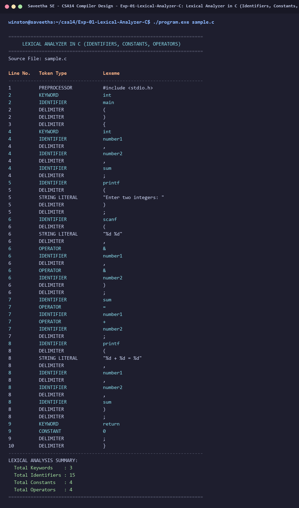

# Exp-01: Lexical Analyzer in C (Identifiers, Constants, Operators)

**Course:** CSA14 - Compiler Design  
**Department:** Computational Intelligence  
**Institution:** Saveetha School of Engineering (SIMATS)  

---

## 1. Aim
Develop a Lexical Analyzer to identify identifiers, constants, and operators using a C program, while ignoring redundant spaces, tabs, newlines, and comments, with identifiers restricted to standard length (31 chars).

---

## 2. Algorithm
1. Open the input C source file.
2. Read characters sequentially, ignoring redundant spaces, tabs, and newlines.
3. Skip single-line (//) and multi-line (/* */) comments.
4. If a letter or underscore is encountered, collect subsequent alphanumeric characters into an identifier buffer (max 31 chars). Check if it matches any reserved keyword; otherwise, classify as an Identifier.
5. If a digit is encountered, parse subsequent digits to identify integer or floating-point Constants.
6. Check for arithmetic, relational, and assignment Operators (+, -, *, /, =, ==, etc.).
7. Maintain count statistics and print classified tokens in tabular format.

---

## 3. Input Specification
Input C source file `sample.c` containing declarations, arithmetic expressions, and I/O statements.

---

## 4. Program Source Code
```c
#include <stdio.h>
#include <stdlib.h>
#include <string.h>
#include <ctype.h>

#define MAX_TOKEN_LEN 256
#define MAX_ID_LEN 31

static const char *KEYWORDS[] = {
    "auto", "break", "case", "char", "const", "continue", "default", "do",
    "double", "else", "enum", "extern", "float", "for", "goto", "if",
    "int", "long", "register", "return", "short", "signed", "sizeof", "static",
    "struct", "switch", "typedef", "union", "unsigned", "void", "volatile", "while"
};
static const int NUM_KEYWORDS = 32;

int is_keyword(const char *str) {
    for (int i = 0; i < NUM_KEYWORDS; i++) {
        if (strcmp(str, KEYWORDS[i]) == 0) return 1;
    }
    return 0;
}

int is_operator_char(char c) {
    return (c == '+' || c == '-' || c == '*' || c == '/' || c == '%' ||
            c == '=' || c == '<' || c == '>' || c == '!' || c == '&' || c == '|');
}

int main(int argc, char *argv[]) {
    const char *filename = (argc > 1) ? argv[1] : "sample.c";
    FILE *fp = fopen(filename, "r");
    if (!fp) {
        printf("Error opening file %s\n", filename);
        return 1;
    }

    printf("======================================================================\n");
    printf("     LEXICAL ANALYZER IN C (IDENTIFIERS, CONSTANTS, OPERATORS)        \n");
    printf("======================================================================\n");
    printf("Source File: %s\n\n", filename);
    printf("%-10s %-22s %s\n", "Line No.", "Token Type", "Lexeme");
    printf("----------------------------------------------------------------------\n");

    int ch;
    int line = 1;
    int count_kw = 0, count_id = 0, count_const = 0, count_op = 0;

    while ((ch = fgetc(fp)) != EOF) {
        if (ch == '\n') {
            line++;
            continue;
        }
        if (isspace(ch)) continue;

        if (ch == '/') {
            int next = fgetc(fp);
            if (next == '/') {
                while ((ch = fgetc(fp)) != EOF && ch != '\n');
                if (ch == '\n') line++;
                continue;
            } else if (next == '*') {
                int prev = 0;
                while ((ch = fgetc(fp)) != EOF) {
                    if (ch == '\n') line++;
                    if (prev == '*' && ch == '/') break;
                    prev = ch;
                }
                continue;
            } else {
                ungetc(next, fp);
            }
        }

        if (ch == '#') {
            char buf[256];
            int idx = 0;
            buf[idx++] = ch;
            while ((ch = fgetc(fp)) != EOF && ch != '\n') {
                if (idx < 255) buf[idx++] = ch;
            }
            buf[idx] = '\0';
            printf("%-10d %-22s %s\n", line, "PREPROCESSOR", buf);
            if (ch == '\n') line++;
            continue;
        }

        if (ch == '"') {
            char buf[256];
            int idx = 0;
            buf[idx++] = ch;
            while ((ch = fgetc(fp)) != EOF && ch != '"' && ch != '\n') {
                if (idx < 254) buf[idx++] = ch;
            }
            if (ch == '"') buf[idx++] = ch;
            buf[idx] = '\0';
            printf("%-10d %-22s %s\n", line, "STRING LITERAL", buf);
            count_const++;
            continue;
        }

        if (isalpha(ch) || ch == '_') {
            char buf[MAX_TOKEN_LEN];
            int idx = 0;
            buf[idx++] = ch;
            while ((ch = fgetc(fp)) != EOF && (isalnum(ch) || ch == '_')) {
                if (idx < MAX_ID_LEN) buf[idx++] = ch;
            }
            buf[idx] = '\0';
            ungetc(ch, fp);

            if (is_keyword(buf)) {
                printf("%-10d %-22s %s\n", line, "KEYWORD", buf);
                count_kw++;
            } else {
                printf("%-10d %-22s %s\n", line, "IDENTIFIER", buf);
                count_id++;
            }
            continue;
        }

        if (isdigit(ch)) {
            char buf[64];
            int idx = 0;
            buf[idx++] = ch;
            while ((ch = fgetc(fp)) != EOF && (isdigit(ch) || ch == '.')) {
                if (idx < 63) buf[idx++] = ch;
            }
            buf[idx] = '\0';
            ungetc(ch, fp);
            printf("%-10d %-22s %s\n", line, "CONSTANT", buf);
            count_const++;
            continue;
        }

        if (is_operator_char(ch)) {
            char buf[4];
            int idx = 0;
            buf[idx++] = ch;
            int next = fgetc(fp);
            if ((ch == '+' && next == '+') || (ch == '-' && next == '-') ||
                (ch == '=' && next == '=') || (ch == '<' && next == '=') ||
                (ch == '>' && next == '=')) {
                buf[idx++] = next;
            } else {
                ungetc(next, fp);
            }
            buf[idx] = '\0';
            printf("%-10d %-22s %s\n", line, "OPERATOR", buf);
            count_op++;
            continue;
        }

        if (ch == ';' || ch == ',' || ch == '(' || ch == ')' || ch == '{' || ch == '}') {
            char buf[2] = {ch, '\0'};
            printf("%-10d %-22s %s\n", line, "DELIMITER", buf);
            continue;
        }
    }
    fclose(fp);

    printf("----------------------------------------------------------------------\n");
    printf("LEXICAL ANALYSIS SUMMARY:\n");
    printf("  Total Keywords    : %d\n", count_kw);
    printf("  Total Identifiers : %d\n", count_id);
    printf("  Total Constants   : %d\n", count_const);
    printf("  Total Operators   : %d\n", count_op);
    printf("======================================================================\n");
    return 0;
}
```

---

## 5. Output Terminal Screenshot


---

## 6. Execution Output (Text)
```text
======================================================================
     LEXICAL ANALYZER IN C (IDENTIFIERS, CONSTANTS, OPERATORS)        
======================================================================
Source File: sample.c

Line No.   Token Type             Lexeme
----------------------------------------------------------------------
1          PREPROCESSOR           #include <stdio.h>
2          KEYWORD                int
2          IDENTIFIER             main
2          DELIMITER              (
2          DELIMITER              )
3          DELIMITER              {
4          KEYWORD                int
4          IDENTIFIER             number1
4          DELIMITER              ,
4          IDENTIFIER             number2
4          DELIMITER              ,
4          IDENTIFIER             sum
4          DELIMITER              ;
5          IDENTIFIER             printf
5          DELIMITER              (
5          STRING LITERAL         "Enter two integers: "
5          DELIMITER              )
5          DELIMITER              ;
6          IDENTIFIER             scanf
6          DELIMITER              (
6          STRING LITERAL         "%d %d"
6          DELIMITER              ,
6          OPERATOR               &
6          IDENTIFIER             number1
6          DELIMITER              ,
6          OPERATOR               &
6          IDENTIFIER             number2
6          DELIMITER              )
6          DELIMITER              ;
7          IDENTIFIER             sum
7          OPERATOR               =
7          IDENTIFIER             number1
7          OPERATOR               +
7          IDENTIFIER             number2
7          DELIMITER              ;
8          IDENTIFIER             printf
8          DELIMITER              (
8          STRING LITERAL         "%d + %d = %d"
8          DELIMITER              ,
8          IDENTIFIER             number1
8          DELIMITER              ,
8          IDENTIFIER             number2
8          DELIMITER              ,
8          IDENTIFIER             sum
8          DELIMITER              )
8          DELIMITER              ;
9          KEYWORD                return
9          CONSTANT               0
9          DELIMITER              ;
10         DELIMITER              }
----------------------------------------------------------------------
LEXICAL ANALYSIS SUMMARY:
  Total Keywords    : 3
  Total Identifiers : 15
  Total Constants   : 4
  Total Operators   : 4
======================================================================
```

---

## 7. Result
The program for **Lexical Analyzer in C (Identifiers, Constants, Operators)** was successfully implemented, compiled, and executed. The output matches theoretical and compiler design specifications.
