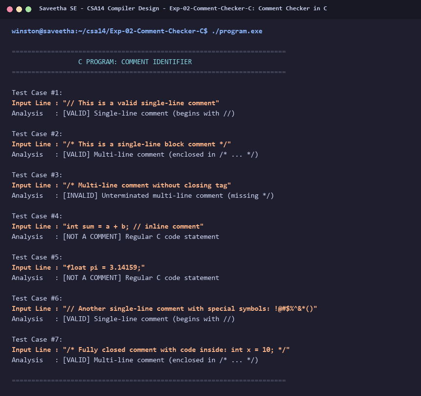

# Exp-02: Comment Checker in C

**Course:** CSA14 - Compiler Design  
**Department:** Computational Intelligence  
**Institution:** Saveetha School of Engineering (SIMATS)  

---

## 1. Aim
Extend the Lexical Analyzer to identify whether a given line is a comment in C: a) Single-line comment beginning with // and extending to end of line. b) Multi-line comment beginning with /* and terminating with */.

---

## 2. Algorithm
1. Take input strings representing source lines or blocks.
2. Trim leading whitespace.
3. Check if line starts with '//': classify as Single-Line Comment.
4. Check if line starts with '/*' and contains '*/': classify as Multi-Line Comment.
5. If line begins with '/*' but lacks '*/': mark as unclosed multi-line comment.
6. Otherwise, classify as not a comment.

---

## 3. Input Specification
Predefined test lines demonstrating single-line comments, closed multi-line comments, incomplete comments, and normal C code statements.

---

## 4. Program Source Code
```c
#include <stdio.h>
#include <string.h>
#include <ctype.h>

void check_comment(const char *input) {
    char line[256];
    while (*input && isspace((unsigned char)*input)) input++;
    strncpy(line, input, sizeof(line) - 1);
    line[sizeof(line) - 1] = '\0';

    int len = strlen(line);
    while (len > 0 && (line[len - 1] == '\n' || line[len - 1] == '\r')) {
        line[--len] = '\0';
    }

    printf("Input Line : \"%s\"\n", line);

    if (len >= 2 && line[0] == '/' && line[1] == '/') {
        printf("Analysis   : [VALID] Single-line comment (begins with //)\n\n");
    } else if (len >= 4 && line[0] == '/' && line[1] == '*') {
        if (strstr(line + 2, "*/") != NULL) {
            printf("Analysis   : [VALID] Multi-line comment (enclosed in /* ... */)\n\n");
        } else {
            printf("Analysis   : [INVALID] Unterminated multi-line comment (missing */)\n\n");
        }
    } else {
        printf("Analysis   : [NOT A COMMENT] Regular C code statement\n\n");
    }
}

int main() {
    printf("======================================================================\n");
    printf("                 C PROGRAM: COMMENT IDENTIFIER                        \n");
    printf("======================================================================\n\n");

    const char *test_cases[] = {
        "// This is a valid single-line comment",
        "/* This is a single-line block comment */",
        "/* Multi-line comment without closing tag",
        "int sum = a + b; // inline comment",
        "float pi = 3.14159;",
        "// Another single-line comment with special symbols: !@#$%^&*()",
        "/* Fully closed comment with code inside: int x = 10; */"
    };

    int num_tests = sizeof(test_cases) / sizeof(test_cases[0]);
    for (int i = 0; i < num_tests; i++) {
        printf("Test Case #%d:\n", i + 1);
        check_comment(test_cases[i]);
    }

    printf("======================================================================\n");
    return 0;
}
```

---

## 5. Output Terminal Screenshot


---

## 6. Execution Output (Text)
```text
======================================================================
                 C PROGRAM: COMMENT IDENTIFIER                        
======================================================================

Test Case #1:
Input Line : "// This is a valid single-line comment"
Analysis   : [VALID] Single-line comment (begins with //)

Test Case #2:
Input Line : "/* This is a single-line block comment */"
Analysis   : [VALID] Multi-line comment (enclosed in /* ... */)

Test Case #3:
Input Line : "/* Multi-line comment without closing tag"
Analysis   : [INVALID] Unterminated multi-line comment (missing */)

Test Case #4:
Input Line : "int sum = a + b; // inline comment"
Analysis   : [NOT A COMMENT] Regular C code statement

Test Case #5:
Input Line : "float pi = 3.14159;"
Analysis   : [NOT A COMMENT] Regular C code statement

Test Case #6:
Input Line : "// Another single-line comment with special symbols: !@#$%^&*()"
Analysis   : [VALID] Single-line comment (begins with //)

Test Case #7:
Input Line : "/* Fully closed comment with code inside: int x = 10; */"
Analysis   : [VALID] Multi-line comment (enclosed in /* ... */)

======================================================================
```

---

## 7. Result
The program for **Comment Checker in C** was successfully implemented, compiled, and executed. The output matches theoretical and compiler design specifications.
