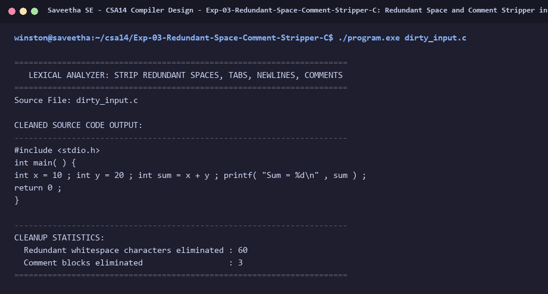

# Exp-03: Redundant Space and Comment Stripper in C

**Course:** CSA14 - Compiler Design  
**Department:** Computational Intelligence  
**Institution:** Saveetha School of Engineering (SIMATS)  

---

## 1. Aim
Design a Lexical Analyzer for a given language to ignore and remove redundant spaces, tabs, newlines, and comments from source code.

---

## 2. Algorithm
1. Open the input file with extra whitespace and comments.
2. Read character by character.
3. Detect single-line and multi-line comments and skip all characters within them.
4. If consecutive spaces or tabs are found, compress them into a single space.
5. If blank lines are found, compress them without preserving redundant line breaks.
6. Print cleaned code and summary statistics of stripped characters.

---

## 3. Input Specification
Input C file `dirty_input.c` containing extra spaces, multiple tabs, blank lines, and comments.

---

## 4. Program Source Code
```c
#include <stdio.h>
#include <ctype.h>

int main(int argc, char *argv[]) {
    const char *filename = (argc > 1) ? argv[1] : "dirty_input.c";
    FILE *fp = fopen(filename, "r");
    if (!fp) {
        printf("Error: Cannot open %s\n", filename);
        return 1;
    }

    printf("======================================================================\n");
    printf("   LEXICAL ANALYZER: STRIP REDUNDANT SPACES, TABS, NEWLINES, COMMENTS \n");
    printf("======================================================================\n");
    printf("Source File: %s\n\n", filename);
    printf("CLEANED SOURCE CODE OUTPUT:\n");
    printf("----------------------------------------------------------------------\n");

    int ch;
    int prev_space = 0;
    int spaces_removed = 0, comments_removed = 0;

    while ((ch = fgetc(fp)) != EOF) {
        if (ch == '/') {
            int next = fgetc(fp);
            if (next == '/') {
                comments_removed++;
                while ((ch = fgetc(fp)) != EOF && ch != '\n');
                continue;
            } else if (next == '*') {
                comments_removed++;
                int prev = 0;
                while ((ch = fgetc(fp)) != EOF) {
                    if (prev == '*' && ch == '/') break;
                    prev = ch;
                }
                continue;
            } else {
                ungetc(next, fp);
            }
        }

        if (ch == ' ' || ch == '\t') {
            if (!prev_space) {
                putchar(' ');
                prev_space = 1;
            } else {
                spaces_removed++;
            }
            continue;
        }

        if (ch == '\n') {
            if (!prev_space) {
                putchar('\n');
                prev_space = 1;
            } else {
                spaces_removed++;
            }
            continue;
        }

        prev_space = 0;
        putchar(ch);
    }
    fclose(fp);

    printf("\n----------------------------------------------------------------------\n");
    printf("CLEANUP STATISTICS:\n");
    printf("  Redundant whitespace characters eliminated : %d\n", spaces_removed);
    printf("  Comment blocks eliminated                  : %d\n", comments_removed);
    printf("======================================================================\n");
    return 0;
}
```

---

## 5. Output Terminal Screenshot


---

## 6. Execution Output (Text)
```text
======================================================================
   LEXICAL ANALYZER: STRIP REDUNDANT SPACES, TABS, NEWLINES, COMMENTS 
======================================================================
Source File: dirty_input.c

CLEANED SOURCE CODE OUTPUT:
----------------------------------------------------------------------
#include <stdio.h>
int main( ) {
int x = 10 ; int y = 20 ; int sum = x + y ; printf( "Sum = %d\n" , sum ) ;
return 0 ;
}

----------------------------------------------------------------------
CLEANUP STATISTICS:
  Redundant whitespace characters eliminated : 60
  Comment blocks eliminated                  : 3
======================================================================
```

---

## 7. Result
The program for **Redundant Space and Comment Stripper in C** was successfully implemented, compiled, and executed. The output matches theoretical and compiler design specifications.
