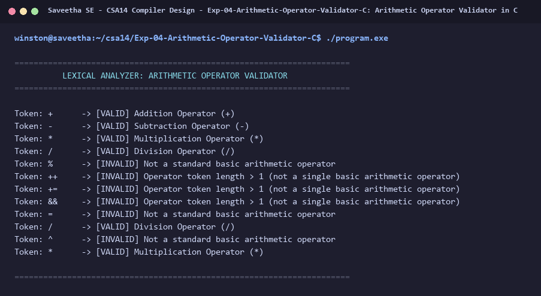

# Exp-04: Arithmetic Operator Validator in C

**Course:** CSA14 - Compiler Design  
**Department:** Computational Intelligence  
**Institution:** Saveetha School of Engineering (SIMATS)  

---

## 1. Aim
Design a Lexical Analyzer to validate and recognize arithmetic operators (+, -, *, /) and differentiate them from other symbols.

---

## 2. Algorithm
1. Read tokens or symbols.
2. Check if single character matches '+', '-', '*', or '/'.
3. Classify:
   - '+' -> Addition Operator
   - '-' -> Subtraction Operator
   - '*' -> Multiplication Operator
   - '/' -> Division Operator
4. If symbol is not an arithmetic operator, flag as invalid/non-arithmetic.

---

## 3. Input Specification
Array of test operators and tokens (+, -, *, /, %, ++, &, ^, =, *).

---

## 4. Program Source Code
```c
#include <stdio.h>
#include <string.h>

void validate_operator(const char *op) {
    printf("Token: %-6s -> ", op);
    if (strlen(op) == 1) {
        switch (op[0]) {
            case '+':
                printf("[VALID] Addition Operator (+)\n");
                break;
            case '-':
                printf("[VALID] Subtraction Operator (-)\n");
                break;
            case '*':
                printf("[VALID] Multiplication Operator (*)\n");
                break;
            case '/':
                printf("[VALID] Division Operator (/)\n");
                break;
            default:
                printf("[INVALID] Not a standard basic arithmetic operator\n");
        }
    } else {
        printf("[INVALID] Operator token length > 1 (not a single basic arithmetic operator)\n");
    }
}

int main() {
    printf("======================================================================\n");
    printf("          LEXICAL ANALYZER: ARITHMETIC OPERATOR VALIDATOR             \n");
    printf("======================================================================\n\n");

    const char *test_tokens[] = {
        "+", "-", "*", "/", "%", "++", "+=", "&&", "=", "/", "^", "*"
    };

    int n = sizeof(test_tokens) / sizeof(test_tokens[0]);
    for (int i = 0; i < n; i++) {
        validate_operator(test_tokens[i]);
    }

    printf("\n======================================================================\n");
    return 0;
}
```

---

## 5. Output Terminal Screenshot


---

## 6. Execution Output (Text)
```text
======================================================================
          LEXICAL ANALYZER: ARITHMETIC OPERATOR VALIDATOR             
======================================================================

Token: +      -> [VALID] Addition Operator (+)
Token: -      -> [VALID] Subtraction Operator (-)
Token: *      -> [VALID] Multiplication Operator (*)
Token: /      -> [VALID] Division Operator (/)
Token: %      -> [INVALID] Not a standard basic arithmetic operator
Token: ++     -> [INVALID] Operator token length > 1 (not a single basic arithmetic operator)
Token: +=     -> [INVALID] Operator token length > 1 (not a single basic arithmetic operator)
Token: &&     -> [INVALID] Operator token length > 1 (not a single basic arithmetic operator)
Token: =      -> [INVALID] Not a standard basic arithmetic operator
Token: /      -> [VALID] Division Operator (/)
Token: ^      -> [INVALID] Not a standard basic arithmetic operator
Token: *      -> [VALID] Multiplication Operator (*)

======================================================================
```

---

## 7. Result
The program for **Arithmetic Operator Validator in C** was successfully implemented, compiled, and executed. The output matches theoretical and compiler design specifications.
