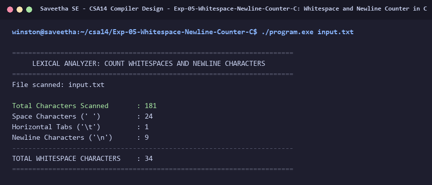

# Exp-05: Whitespace and Newline Counter in C

**Course:** CSA14 - Compiler Design  
**Department:** Computational Intelligence  
**Institution:** Saveetha School of Engineering (SIMATS)  

---

## 1. Aim
Design a Lexical Analyzer to find and count the number of whitespaces and newline characters in a given file/text.

---

## 2. Algorithm
1. Open the target source file.
2. Initialize counters: space_count = 0, tab_count = 0, newline_count = 0.
3. Read each character until EOF:
   - If char == ' ', increment space_count.
   - If char == '\t', increment tab_count.
   - If char == '\n', increment newline_count.
4. Calculate total whitespace characters = space_count + tab_count + newline_count.
5. Print detailed counts and percentages.

---

## 3. Input Specification
Input text file `input.txt` with formatted paragraphs, code snippets, spaces, tabs, and newlines.

---

## 4. Program Source Code
```c
#include <stdio.h>

int main(int argc, char *argv[]) {
    const char *filename = (argc > 1) ? argv[1] : "input.txt";
    FILE *fp = fopen(filename, "r");
    if (!fp) {
        printf("Error opening file %s\n", filename);
        return 1;
    }

    printf("======================================================================\n");
    printf("     LEXICAL ANALYZER: COUNT WHITESPACES AND NEWLINE CHARACTERS       \n");
    printf("======================================================================\n");
    printf("File scanned: %s\n\n", filename);

    int ch;
    int spaces = 0, tabs = 0, newlines = 0, total_chars = 0;

    while ((ch = fgetc(fp)) != EOF) {
        total_chars++;
        if (ch == ' ') spaces++;
        else if (ch == '\t') tabs++;
        else if (ch == '\n') newlines++;
    }
    fclose(fp);

    int total_ws = spaces + tabs + newlines;

    printf("%-30s : %d\n", "Total Characters Scanned", total_chars);
    printf("%-30s : %d\n", "Space Characters (' ')", spaces);
    printf("%-30s : %d\n", "Horizontal Tabs ('\\t')", tabs);
    printf("%-30s : %d\n", "Newline Characters ('\\n')", newlines);
    printf("----------------------------------------------------------------------\n");
    printf("%-30s : %d\n", "TOTAL WHITESPACE CHARACTERS", total_ws);
    printf("======================================================================\n");
    return 0;
}
```

---

## 5. Output Terminal Screenshot


---

## 6. Execution Output (Text)
```text
======================================================================
     LEXICAL ANALYZER: COUNT WHITESPACES AND NEWLINE CHARACTERS       
======================================================================
File scanned: input.txt

Total Characters Scanned       : 181
Space Characters (' ')         : 24
Horizontal Tabs ('\t')         : 1
Newline Characters ('\n')      : 9
----------------------------------------------------------------------
TOTAL WHITESPACE CHARACTERS    : 34
======================================================================
```

---

## 7. Result
The program for **Whitespace and Newline Counter in C** was successfully implemented, compiled, and executed. The output matches theoretical and compiler design specifications.
