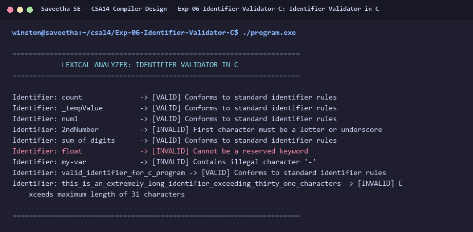

# Exp-06: Identifier Validator in C

**Course:** CSA14 - Compiler Design  
**Department:** Computational Intelligence  
**Institution:** Saveetha School of Engineering (SIMATS)  

---

## 1. Aim
Develop a Lexical Analyzer to test whether a given identifier is valid or not according to programming language specification rules.

---

## 2. Algorithm
1. Take input string representing an identifier candidate.
2. Check if length is between 1 and 31 characters.
3. Verify first character is an alphabet (a-z, A-Z) or underscore (_). If not, declare INVALID.
4. Verify all remaining characters are alphanumeric or underscore. If any other character exists, declare INVALID.
5. Check against the 32 C reserved keywords. If matched, declare INVALID.
6. If all checks pass, declare VALID IDENTIFIER.

---

## 3. Input Specification
Array of valid and invalid test identifier strings.

---

## 4. Program Source Code
```c
#include <stdio.h>
#include <string.h>
#include <ctype.h>

static const char *KEYWORDS[] = {
    "auto", "break", "case", "char", "const", "continue", "default", "do",
    "double", "else", "enum", "extern", "float", "for", "goto", "if",
    "int", "long", "register", "return", "short", "signed", "sizeof", "static",
    "struct", "switch", "typedef", "union", "unsigned", "void", "volatile", "while"
};
static const int NUM_KEYWORDS = 32;

int is_keyword(const char *str) {
    for (int i = 0; i < NUM_KEYWORDS; i++) {
        if (strcmp(str, KEYWORDS[i]) == 0) return 1;
    }
    return 0;
}

void validate_identifier(const char *id) {
    printf("Identifier: %-18s -> ", id);

    int len = strlen(id);
    if (len == 0) {
        printf("[INVALID] Identifier cannot be empty\n");
        return;
    }
    if (len > 31) {
        printf("[INVALID] Exceeds maximum length of 31 characters\n");
        return;
    }
    if (is_keyword(id)) {
        printf("[INVALID] Cannot be a reserved keyword\n");
        return;
    }
    if (!isalpha(id[0]) && id[0] != '_') {
        printf("[INVALID] First character must be a letter or underscore\n");
        return;
    }
    for (int i = 1; i < len; i++) {
        if (!isalnum(id[i]) && id[i] != '_') {
            printf("[INVALID] Contains illegal character '%c'\n", id[i]);
            return;
        }
    }
    printf("[VALID] Conforms to standard identifier rules\n");
}

int main() {
    printf("======================================================================\n");
    printf("            LEXICAL ANALYZER: IDENTIFIER VALIDATOR IN C               \n");
    printf("======================================================================\n\n");

    const char *test_ids[] = {
        "count",
        "_tempValue",
        "num1",
        "2ndNumber",
        "sum_of_digits",
        "float",
        "my-var",
        "valid_identifier_for_c_program",
        "this_is_an_extremely_long_identifier_exceeding_thirty_one_characters"
    };

    int n = sizeof(test_ids) / sizeof(test_ids[0]);
    for (int i = 0; i < n; i++) {
        validate_identifier(test_ids[i]);
    }

    printf("\n======================================================================\n");
    return 0;
}
```

---

## 5. Output Terminal Screenshot


---

## 6. Execution Output (Text)
```text
======================================================================
            LEXICAL ANALYZER: IDENTIFIER VALIDATOR IN C               
======================================================================

Identifier: count              -> [VALID] Conforms to standard identifier rules
Identifier: _tempValue         -> [VALID] Conforms to standard identifier rules
Identifier: num1               -> [VALID] Conforms to standard identifier rules
Identifier: 2ndNumber          -> [INVALID] First character must be a letter or underscore
Identifier: sum_of_digits      -> [VALID] Conforms to standard identifier rules
Identifier: float              -> [INVALID] Cannot be a reserved keyword
Identifier: my-var             -> [INVALID] Contains illegal character '-'
Identifier: valid_identifier_for_c_program -> [VALID] Conforms to standard identifier rules
Identifier: this_is_an_extremely_long_identifier_exceeding_thirty_one_characters -> [INVALID] Exceeds maximum length of 31 characters

======================================================================
```

---

## 7. Result
The program for **Identifier Validator in C** was successfully implemented, compiled, and executed. The output matches theoretical and compiler design specifications.
