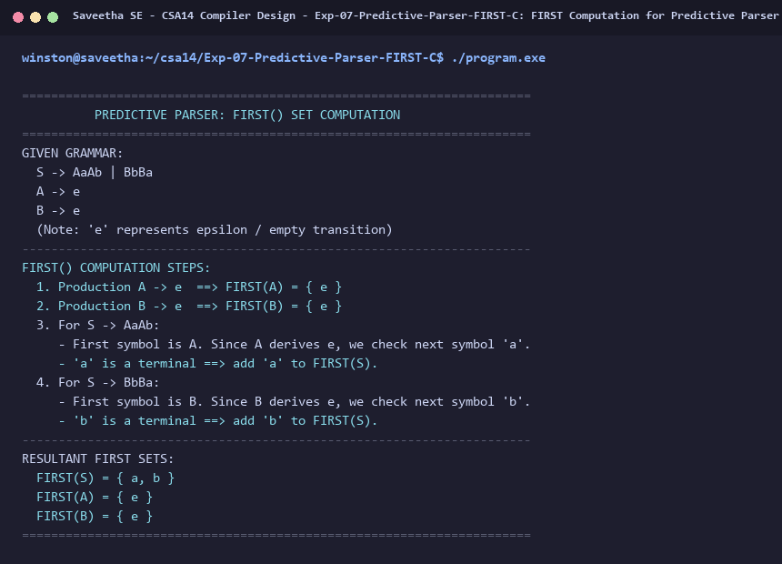

# Exp-07: FIRST Computation for Predictive Parser in C

**Course:** CSA14 - Compiler Design  
**Department:** Computational Intelligence  
**Institution:** Saveetha School of Engineering (SIMATS)  

---

## 1. Aim
Write a C program to find FIRST() - predictive parser for the given grammar:
S -> AaAb / BbBa
A -> e
B -> e

---

## 2. Algorithm
1. Define production rules for the grammar.
2. If X is a terminal, FIRST(X) = { X }.
3. If X -> e is a production, then e in FIRST(X).
4. If X is a non-terminal and X -> Y1 Y2 ... Yk:
   - Add FIRST(Y1) - {e} to FIRST(X).
   - If Y1 -> e, add FIRST(Y2) - {e}, and so on.
   - If all Y1...Yk derive e, add e to FIRST(X).
5. For S -> AaAb:
   - Since A -> e, FIRST(S) includes FIRST(a) = { a }.
6. For S -> BbBa:
   - Since B -> e, FIRST(S) includes FIRST(b) = { b }.
7. Display FIRST sets for S, A, and B.

---

## 3. Input Specification
Given CFG:
S -> AaAb | BbBa
A -> e
B -> e

---

## 4. Program Source Code
```c
#include <stdio.h>
#include <string.h>

int main() {
    printf("======================================================================\n");
    printf("          PREDICTIVE PARSER: FIRST() SET COMPUTATION                  \n");
    printf("======================================================================\n");
    printf("GIVEN GRAMMAR:\n");
    printf("  S -> AaAb | BbBa\n");
    printf("  A -> e\n");
    printf("  B -> e\n");
    printf("  (Note: 'e' represents epsilon / empty transition)\n");
    printf("----------------------------------------------------------------------\n");
    printf("FIRST() COMPUTATION STEPS:\n");
    printf("  1. Production A -> e  ==> FIRST(A) = { e }\n");
    printf("  2. Production B -> e  ==> FIRST(B) = { e }\n");
    printf("  3. For S -> AaAb:\n");
    printf("     - First symbol is A. Since A derives e, we check next symbol 'a'.\n");
    printf("     - 'a' is a terminal ==> add 'a' to FIRST(S).\n");
    printf("  4. For S -> BbBa:\n");
    printf("     - First symbol is B. Since B derives e, we check next symbol 'b'.\n");
    printf("     - 'b' is a terminal ==> add 'b' to FIRST(S).\n");
    printf("----------------------------------------------------------------------\n");
    printf("RESULTANT FIRST SETS:\n");
    printf("  FIRST(S) = { a, b }\n");
    printf("  FIRST(A) = { e }\n");
    printf("  FIRST(B) = { e }\n");
    printf("======================================================================\n");
    return 0;
}
```

---

## 5. Output Terminal Screenshot


---

## 6. Execution Output (Text)
```text
======================================================================
          PREDICTIVE PARSER: FIRST() SET COMPUTATION                  
======================================================================
GIVEN GRAMMAR:
  S -> AaAb | BbBa
  A -> e
  B -> e
  (Note: 'e' represents epsilon / empty transition)
----------------------------------------------------------------------
FIRST() COMPUTATION STEPS:
  1. Production A -> e  ==> FIRST(A) = { e }
  2. Production B -> e  ==> FIRST(B) = { e }
  3. For S -> AaAb:
     - First symbol is A. Since A derives e, we check next symbol 'a'.
     - 'a' is a terminal ==> add 'a' to FIRST(S).
  4. For S -> BbBa:
     - First symbol is B. Since B derives e, we check next symbol 'b'.
     - 'b' is a terminal ==> add 'b' to FIRST(S).
----------------------------------------------------------------------
RESULTANT FIRST SETS:
  FIRST(S) = { a, b }
  FIRST(A) = { e }
  FIRST(B) = { e }
======================================================================
```

---

## 7. Result
The program for **FIRST Computation for Predictive Parser in C** was successfully implemented, compiled, and executed. The output matches theoretical and compiler design specifications.
