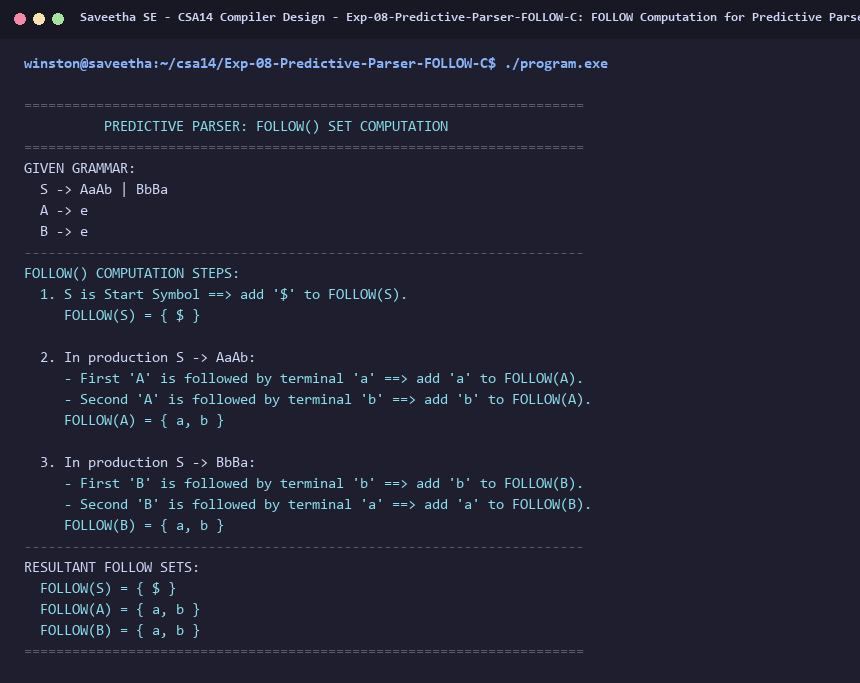

# Exp-08: FOLLOW Computation for Predictive Parser in C

**Course:** CSA14 - Compiler Design  
**Department:** Computational Intelligence  
**Institution:** Saveetha School of Engineering (SIMATS)  

---

## 1. Aim
Write a C program to find FOLLOW() - predictive parser for the given grammar:
S -> AaAb / BbBa
A -> e
B -> e

---

## 2. Algorithm
1. Place $ in FOLLOW(S) where S is the start symbol.
2. For production A -> alpha B beta:
   - Everything in FIRST(beta) except e is in FOLLOW(B).
   - If beta -> e, everything in FOLLOW(A) is in FOLLOW(B).
3. In S -> AaAb:
   - First A is followed by terminal 'a' ==> a in FOLLOW(A).
   - Second A is followed by terminal 'b' ==> b in FOLLOW(A).
   - Hence FOLLOW(A) = { a, b }.
4. In S -> BbBa:
   - First B is followed by terminal 'b' ==> b in FOLLOW(B).
   - Second B is followed by terminal 'a' ==> a in FOLLOW(B).
   - Hence FOLLOW(B) = { a, b }.
5. Print FOLLOW sets for S, A, and B.

---

## 3. Input Specification
Given CFG:
S -> AaAb | BbBa
A -> e
B -> e

---

## 4. Program Source Code
```c
#include <stdio.h>

int main() {
    printf("======================================================================\n");
    printf("          PREDICTIVE PARSER: FOLLOW() SET COMPUTATION                 \n");
    printf("======================================================================\n");
    printf("GIVEN GRAMMAR:\n");
    printf("  S -> AaAb | BbBa\n");
    printf("  A -> e\n");
    printf("  B -> e\n");
    printf("----------------------------------------------------------------------\n");
    printf("FOLLOW() COMPUTATION STEPS:\n");
    printf("  1. S is Start Symbol ==> add '$' to FOLLOW(S).\n");
    printf("     FOLLOW(S) = { $ }\n\n");
    printf("  2. In production S -> AaAb:\n");
    printf("     - First 'A' is followed by terminal 'a' ==> add 'a' to FOLLOW(A).\n");
    printf("     - Second 'A' is followed by terminal 'b' ==> add 'b' to FOLLOW(A).\n");
    printf("     FOLLOW(A) = { a, b }\n\n");
    printf("  3. In production S -> BbBa:\n");
    printf("     - First 'B' is followed by terminal 'b' ==> add 'b' to FOLLOW(B).\n");
    printf("     - Second 'B' is followed by terminal 'a' ==> add 'a' to FOLLOW(B).\n");
    printf("     FOLLOW(B) = { a, b }\n");
    printf("----------------------------------------------------------------------\n");
    printf("RESULTANT FOLLOW SETS:\n");
    printf("  FOLLOW(S) = { $ }\n");
    printf("  FOLLOW(A) = { a, b }\n");
    printf("  FOLLOW(B) = { a, b }\n");
    printf("======================================================================\n");
    return 0;
}
```

---

## 5. Output Terminal Screenshot


---

## 6. Execution Output (Text)
```text
======================================================================
          PREDICTIVE PARSER: FOLLOW() SET COMPUTATION                 
======================================================================
GIVEN GRAMMAR:
  S -> AaAb | BbBa
  A -> e
  B -> e
----------------------------------------------------------------------
FOLLOW() COMPUTATION STEPS:
  1. S is Start Symbol ==> add '$' to FOLLOW(S).
     FOLLOW(S) = { $ }

  2. In production S -> AaAb:
     - First 'A' is followed by terminal 'a' ==> add 'a' to FOLLOW(A).
     - Second 'A' is followed by terminal 'b' ==> add 'b' to FOLLOW(A).
     FOLLOW(A) = { a, b }

  3. In production S -> BbBa:
     - First 'B' is followed by terminal 'b' ==> add 'b' to FOLLOW(B).
     - Second 'B' is followed by terminal 'a' ==> add 'a' to FOLLOW(B).
     FOLLOW(B) = { a, b }
----------------------------------------------------------------------
RESULTANT FOLLOW SETS:
  FOLLOW(S) = { $ }
  FOLLOW(A) = { a, b }
  FOLLOW(B) = { a, b }
======================================================================
```

---

## 7. Result
The program for **FOLLOW Computation for Predictive Parser in C** was successfully implemented, compiled, and executed. The output matches theoretical and compiler design specifications.
