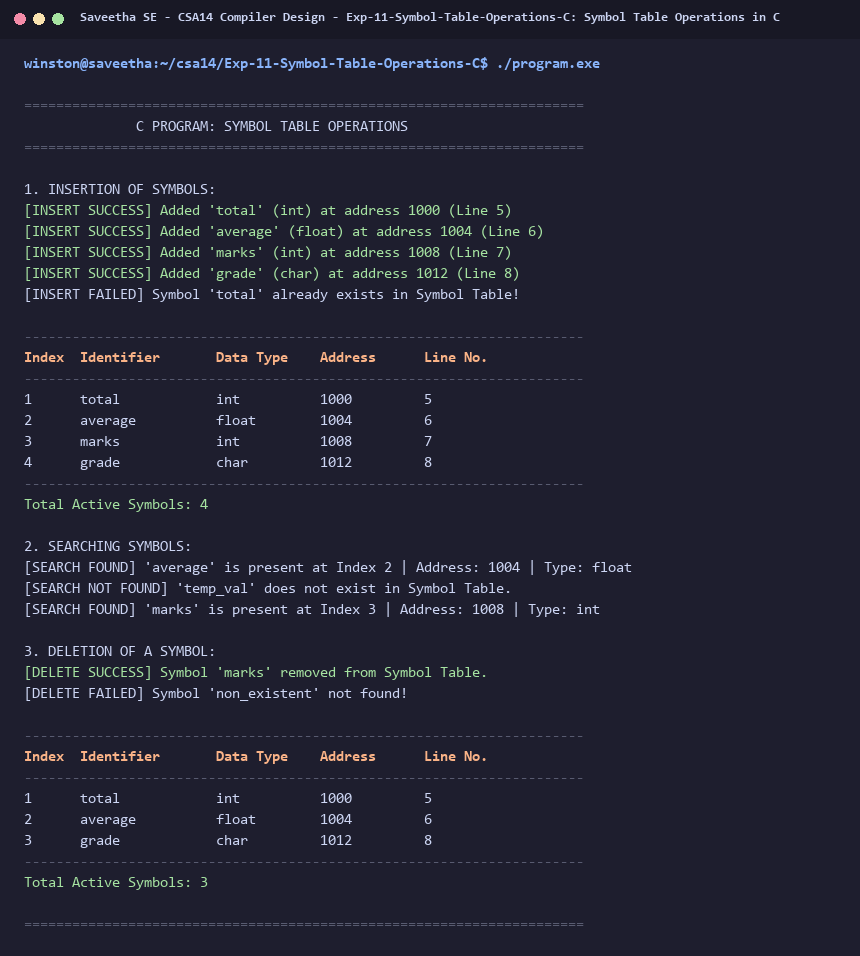

# Exp-11: Symbol Table Operations in C

**Course:** CSA14 - Compiler Design  
**Department:** Computational Intelligence  
**Institution:** Saveetha School of Engineering (SIMATS)  

---

## 1. Aim
Implement a C program to perform symbol table operations including Insert, Search, Display, and Delete with symbol attributes such as Name, Type, and Address.

---

## 2. Algorithm
1. Define a Symbol Table record structure containing: symbol name, data type, memory address, and line number.
2. Maintain an array / hash table of symbol entries.
3. Operation INSERT: Check if symbol already exists; if not, allocate memory address and add entry.
4. Operation SEARCH: Linearly search for symbol by name; return index and attributes if found, else not found.
5. Operation DISPLAY: Print all active records in formatted tabular structure.
6. Operation DELETE: Locate symbol; shift subsequent elements to remove it and decrement count.
7. Execute automated sequence demonstrating all operations.

---

## 3. Input Specification
Interactive / automated sequence of Insert, Search, Display, and Delete actions.

---

## 4. Program Source Code
```c
#include <stdio.h>
#include <string.h>

#define MAX 50

typedef struct {
    char name[32];
    char type[16];
    int address;
    int line;
} Symbol;

Symbol table[MAX];
int count = 0;
int next_addr = 1000;

int search_symbol(const char *name) {
    for (int i = 0; i < count; i++) {
        if (strcmp(table[i].name, name) == 0) return i;
    }
    return -1;
}

void insert_symbol(const char *name, const char *type, int line) {
    if (search_symbol(name) != -1) {
        printf("[INSERT FAILED] Symbol '%s' already exists in Symbol Table!\n", name);
        return;
    }
    if (count >= MAX) {
        printf("[INSERT FAILED] Symbol Table is full!\n");
        return;
    }
    strcpy(table[count].name, name);
    strcpy(table[count].type, type);
    table[count].address = next_addr;
    table[count].line = line;
    next_addr += (strcmp(type, "int") == 0 ? 4 : (strcmp(type, "float") == 0 ? 4 : 8));
    printf("[INSERT SUCCESS] Added '%s' (%s) at address %d (Line %d)\n", name, type, table[count].address, line);
    count++;
}

void display_table() {
    printf("\n----------------------------------------------------------------------\n");
    printf("%-6s %-16s %-12s %-12s %-8s\n", "Index", "Identifier", "Data Type", "Address", "Line No.");
    printf("----------------------------------------------------------------------\n");
    for (int i = 0; i < count; i++) {
        printf("%-6d %-16s %-12s %-12d %-8d\n", i + 1, table[i].name, table[i].type, table[i].address, table[i].line);
    }
    printf("----------------------------------------------------------------------\n");
    printf("Total Active Symbols: %d\n\n", count);
}

void delete_symbol(const char *name) {
    int idx = search_symbol(name);
    if (idx == -1) {
        printf("[DELETE FAILED] Symbol '%s' not found!\n", name);
        return;
    }
    for (int i = idx; i < count - 1; i++) {
        table[i] = table[i + 1];
    }
    count--;
    printf("[DELETE SUCCESS] Symbol '%s' removed from Symbol Table.\n", name);
}

int main() {
    printf("======================================================================\n");
    printf("              C PROGRAM: SYMBOL TABLE OPERATIONS                      \n");
    printf("======================================================================\n\n");

    printf("1. INSERTION OF SYMBOLS:\n");
    insert_symbol("total", "int", 5);
    insert_symbol("average", "float", 6);
    insert_symbol("marks", "int", 7);
    insert_symbol("grade", "char", 8);
    insert_symbol("total", "int", 10); // Duplicate test

    display_table();

    printf("2. SEARCHING SYMBOLS:\n");
    const char *queries[] = {"average", "temp_val", "marks"};
    for (int i = 0; i < 3; i++) {
        int idx = search_symbol(queries[i]);
        if (idx != -1) {
            printf("[SEARCH FOUND] '%s' is present at Index %d | Address: %d | Type: %s\n", 
                   queries[i], idx + 1, table[idx].address, table[idx].type);
        } else {
            printf("[SEARCH NOT FOUND] '%s' does not exist in Symbol Table.\n", queries[i]);
        }
    }

    printf("\n3. DELETION OF A SYMBOL:\n");
    delete_symbol("marks");
    delete_symbol("non_existent");

    display_table();

    printf("======================================================================\n");
    return 0;
}
```

---

## 5. Output Terminal Screenshot


---

## 6. Execution Output (Text)
```text
======================================================================
              C PROGRAM: SYMBOL TABLE OPERATIONS                      
======================================================================

1. INSERTION OF SYMBOLS:
[INSERT SUCCESS] Added 'total' (int) at address 1000 (Line 5)
[INSERT SUCCESS] Added 'average' (float) at address 1004 (Line 6)
[INSERT SUCCESS] Added 'marks' (int) at address 1008 (Line 7)
[INSERT SUCCESS] Added 'grade' (char) at address 1012 (Line 8)
[INSERT FAILED] Symbol 'total' already exists in Symbol Table!

----------------------------------------------------------------------
Index  Identifier       Data Type    Address      Line No.
----------------------------------------------------------------------
1      total            int          1000         5       
2      average          float        1004         6       
3      marks            int          1008         7       
4      grade            char         1012         8       
----------------------------------------------------------------------
Total Active Symbols: 4

2. SEARCHING SYMBOLS:
[SEARCH FOUND] 'average' is present at Index 2 | Address: 1004 | Type: float
[SEARCH NOT FOUND] 'temp_val' does not exist in Symbol Table.
[SEARCH FOUND] 'marks' is present at Index 3 | Address: 1008 | Type: int

3. DELETION OF A SYMBOL:
[DELETE SUCCESS] Symbol 'marks' removed from Symbol Table.
[DELETE FAILED] Symbol 'non_existent' not found!

----------------------------------------------------------------------
Index  Identifier       Data Type    Address      Line No.
----------------------------------------------------------------------
1      total            int          1000         5       
2      average          float        1004         6       
3      grade            char         1012         8       
----------------------------------------------------------------------
Total Active Symbols: 3

======================================================================
```

---

## 7. Result
The program for **Symbol Table Operations in C** was successfully implemented, compiled, and executed. The output matches theoretical and compiler design specifications.
