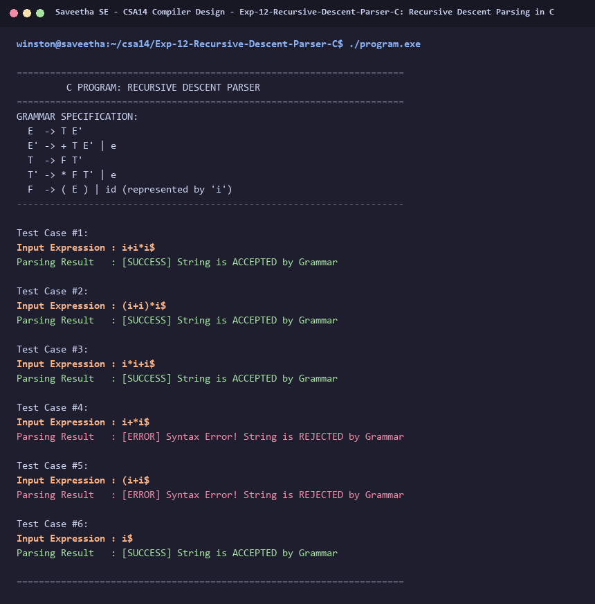

# Exp-12: Recursive Descent Parsing in C

**Course:** CSA14 - Compiler Design  
**Department:** Computational Intelligence  
**Institution:** Saveetha School of Engineering (SIMATS)  

---

## 1. Aim
Write a C program to construct recursive descent parsing for the given grammar:
E  -> T E'
E' -> + T E' / e
T  -> F T'
T' -> * F T' / e
F  -> ( E ) / id

---

## 2. Algorithm
1. Define recursive functions matching each non-terminal: E(), Eprime(), T(), Tprime(), F().
2. Maintain a global lookahead pointer tracking current character position in the input string.
3. Treat 'i' or 'id' as the identifier token.
4. In each function, follow the production rules:
   - E(): calls T() then Eprime().
   - Eprime(): if lookahead is '+', advance pointer, call T(), then call Eprime(); else epsilon (return success).
   - T(): calls F() then Tprime().
   - Tprime(): if lookahead is '*', advance pointer, call F(), then call Tprime(); else epsilon (return success).
   - F(): if lookahead is '(', advance, call E(), match ')'; else if 'i', match 'i' (id); else syntax error.
5. If parse finishes with lookahead pointing to string terminator '$', input string is successfully parsed and accepted.

---

## 3. Input Specification
Test strings such as `i+i*i$` (valid) and `i*+i$` (invalid).

---

## 4. Program Source Code
```c
#include <stdio.h>
#include <string.h>

const char *cursor;
int error_flag = 0;

void E();
void Eprime();
void T();
void Tprime();
void F();

void match(char expected) {
    if (*cursor == expected) {
        cursor++;
    } else {
        error_flag = 1;
    }
}

void E() {
    if (error_flag) return;
    T();
    Eprime();
}

void Eprime() {
    if (error_flag) return;
    if (*cursor == '+') {
        match('+');
        T();
        Eprime();
    }
    // Epsilon transition -> return
}

void T() {
    if (error_flag) return;
    F();
    Tprime();
}

void Tprime() {
    if (error_flag) return;
    if (*cursor == '*') {
        match('*');
        F();
        Tprime();
    }
    // Epsilon transition -> return
}

void F() {
    if (error_flag) return;
    if (*cursor == '(') {
        match('(');
        E();
        match(')');
    } else if (*cursor == 'i') {
        // 'i' represents 'id'
        match('i');
    } else {
        error_flag = 1;
    }
}

void test_string(const char *str) {
    cursor = str;
    error_flag = 0;
    printf("Input Expression : %s\n", str);
    E();
    if (!error_flag && *cursor == '$') {
        printf("Parsing Result   : [SUCCESS] String is ACCEPTED by Grammar\n\n");
    } else {
        printf("Parsing Result   : [ERROR] Syntax Error! String is REJECTED by Grammar\n\n");
    }
}

int main() {
    printf("======================================================================\n");
    printf("         C PROGRAM: RECURSIVE DESCENT PARSER                          \n");
    printf("======================================================================\n");
    printf("GRAMMAR SPECIFICATION:\n");
    printf("  E  -> T E'\n");
    printf("  E' -> + T E' | e\n");
    printf("  T  -> F T'\n");
    printf("  T' -> * F T' | e\n");
    printf("  F  -> ( E ) | id (represented by 'i')\n");
    printf("----------------------------------------------------------------------\n\n");

    const char *test_cases[] = {
        "i+i*i$",
        "(i+i)*i$",
        "i*i+i$",
        "i+*i$",
        "(i+i$",
        "i$"
    };

    int n = sizeof(test_cases) / sizeof(test_cases[0]);
    for (int i = 0; i < n; i++) {
        printf("Test Case #%d:\n", i + 1);
        test_string(test_cases[i]);
    }

    printf("======================================================================\n");
    return 0;
}
```

---

## 5. Output Terminal Screenshot


---

## 6. Execution Output (Text)
```text
======================================================================
         C PROGRAM: RECURSIVE DESCENT PARSER                          
======================================================================
GRAMMAR SPECIFICATION:
  E  -> T E'
  E' -> + T E' | e
  T  -> F T'
  T' -> * F T' | e
  F  -> ( E ) | id (represented by 'i')
----------------------------------------------------------------------

Test Case #1:
Input Expression : i+i*i$
Parsing Result   : [SUCCESS] String is ACCEPTED by Grammar

Test Case #2:
Input Expression : (i+i)*i$
Parsing Result   : [SUCCESS] String is ACCEPTED by Grammar

Test Case #3:
Input Expression : i*i+i$
Parsing Result   : [SUCCESS] String is ACCEPTED by Grammar

Test Case #4:
Input Expression : i+*i$
Parsing Result   : [ERROR] Syntax Error! String is REJECTED by Grammar

Test Case #5:
Input Expression : (i+i$
Parsing Result   : [ERROR] Syntax Error! String is REJECTED by Grammar

Test Case #6:
Input Expression : i$
Parsing Result   : [SUCCESS] String is ACCEPTED by Grammar

======================================================================
```

---

## 7. Result
The program for **Recursive Descent Parsing in C** was successfully implemented, compiled, and executed. The output matches theoretical and compiler design specifications.
