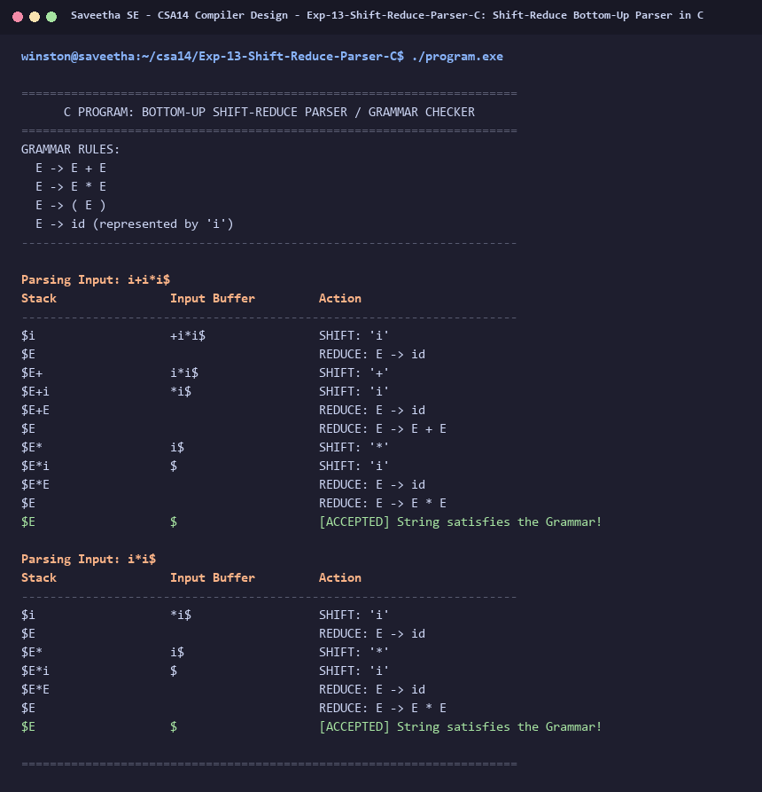

# Exp-13: Shift-Reduce Bottom-Up Parser in C

**Course:** CSA14 - Compiler Design  
**Department:** Computational Intelligence  
**Institution:** Saveetha School of Engineering (SIMATS)  

---

## 1. Aim
Implement a Bottom-Up Shift-Reduce Parsing technique in C to verify whether a given input string satisfies the grammar rules of a language.

---

## 2. Algorithm
1. Define grammar productions:
   E -> E + E
   E -> E * E
   E -> ( E )
   E -> id
2. Initialize Stack with '$' and Input buffer with input string terminated by '$'.
3. In each step:
   - Check if top of stack matches any right-hand side of productions.
   - If match found, REDUCE: replace right-hand side with left-hand side non-terminal (E).
   - If no reduction possible and input buffer not empty, SHIFT: push next input symbol onto stack.
   - If stack contains '$E' and input is '$', ACCEPT string.
   - If neither shift nor reduce is possible, REJECT (Syntax Error).
4. Print trace table displaying Stack, Input, and Action at every step.

---

## 3. Input Specification
Test strings such as `i+i*i` and `i++i`.

---

## 4. Program Source Code
```c
#include <stdio.h>
#include <string.h>

char stack[64];
int top = -1;

void push(char c) {
    stack[++top] = c;
    stack[top + 1] = '\0';
}

void pop(int n) {
    top -= n;
    stack[top + 1] = '\0';
}

int check_reduce() {
    // E -> id (represented by 'i')
    if (top >= 0 && stack[top] == 'i') {
        pop(1);
        push('E');
        printf("%-20s %-20s %s\n", stack, "", "REDUCE: E -> id");
        return 1;
    }
    // E -> E + E
    if (top >= 2 && stack[top - 2] == 'E' && stack[top - 1] == '+' && stack[top] == 'E') {
        pop(3);
        push('E');
        printf("%-20s %-20s %s\n", stack, "", "REDUCE: E -> E + E");
        return 1;
    }
    // E -> E * E
    if (top >= 2 && stack[top - 2] == 'E' && stack[top - 1] == '*' && stack[top] == 'E') {
        pop(3);
        push('E');
        printf("%-20s %-20s %s\n", stack, "", "REDUCE: E -> E * E");
        return 1;
    }
    // E -> ( E )
    if (top >= 2 && stack[top - 2] == '(' && stack[top - 1] == 'E' && stack[top] == ')') {
        pop(3);
        push('E');
        printf("%-20s %-20s %s\n", stack, "", "REDUCE: E -> ( E )");
        return 1;
    }
    return 0;
}

void parse(const char *input_str) {
    char input[64];
    strcpy(input, input_str);
    int in_idx = 0;
    top = -1;
    push('$');

    printf("Parsing Input: %s\n", input_str);
    printf("%-20s %-20s %s\n", "Stack", "Input Buffer", "Action");
    printf("----------------------------------------------------------------------\n");

    while (1) {
        // Repeated reductions if possible
        while (check_reduce());

        // Check acceptance
        if (top == 1 && stack[0] == '$' && stack[1] == 'E' && input[in_idx] == '$') {
            printf("%-20s %-20s %s\n", stack, &input[in_idx], "[ACCEPTED] String satisfies the Grammar!");
            break;
        }

        // Shift next character
        if (input[in_idx] != '$') {
            char next_sym = input[in_idx++];
            push(next_sym);
            char action_buf[32];
            sprintf(action_buf, "SHIFT: '%c'", next_sym);
            printf("%-20s %-20s %s\n", stack, &input[in_idx], action_buf);
        } else {
            // Cannot shift and cannot reduce
            printf("%-20s %-20s %s\n", stack, &input[in_idx], "[REJECTED] Syntax Error: String violates grammar!");
            break;
        }
    }
    printf("\n");
}

int main() {
    printf("======================================================================\n");
    printf("      C PROGRAM: BOTTOM-UP SHIFT-REDUCE PARSER / GRAMMAR CHECKER      \n");
    printf("======================================================================\n");
    printf("GRAMMAR RULES:\n");
    printf("  E -> E + E\n");
    printf("  E -> E * E\n");
    printf("  E -> ( E )\n");
    printf("  E -> id (represented by 'i')\n");
    printf("----------------------------------------------------------------------\n\n");

    parse("i+i*i$");
    parse("i*i$");

    printf("======================================================================\n");
    return 0;
}
```

---

## 5. Output Terminal Screenshot


---

## 6. Execution Output (Text)
```text
======================================================================
      C PROGRAM: BOTTOM-UP SHIFT-REDUCE PARSER / GRAMMAR CHECKER      
======================================================================
GRAMMAR RULES:
  E -> E + E
  E -> E * E
  E -> ( E )
  E -> id (represented by 'i')
----------------------------------------------------------------------

Parsing Input: i+i*i$
Stack                Input Buffer         Action
----------------------------------------------------------------------
$i                   +i*i$                SHIFT: 'i'
$E                                        REDUCE: E -> id
$E+                  i*i$                 SHIFT: '+'
$E+i                 *i$                  SHIFT: 'i'
$E+E                                      REDUCE: E -> id
$E                                        REDUCE: E -> E + E
$E*                  i$                   SHIFT: '*'
$E*i                 $                    SHIFT: 'i'
$E*E                                      REDUCE: E -> id
$E                                        REDUCE: E -> E * E
$E                   $                    [ACCEPTED] String satisfies the Grammar!

Parsing Input: i*i$
Stack                Input Buffer         Action
----------------------------------------------------------------------
$i                   *i$                  SHIFT: 'i'
$E                                        REDUCE: E -> id
$E*                  i$                   SHIFT: '*'
$E*i                 $                    SHIFT: 'i'
$E*E                                      REDUCE: E -> id
$E                                        REDUCE: E -> E * E
$E                   $                    [ACCEPTED] String satisfies the Grammar!

======================================================================
```

---

## 7. Result
The program for **Shift-Reduce Bottom-Up Parser in C** was successfully implemented, compiled, and executed. The output matches theoretical and compiler design specifications.
