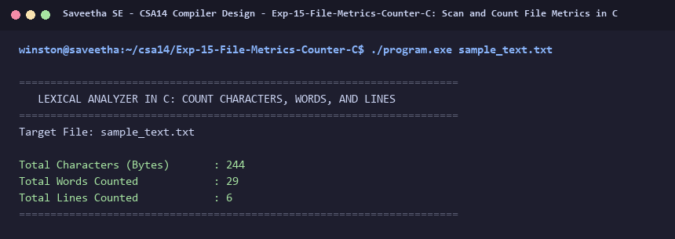

# Exp-15: Scan and Count File Metrics in C

**Course:** CSA14 - Compiler Design  
**Department:** Computational Intelligence  
**Institution:** Saveetha School of Engineering (SIMATS)  

---

## 1. Aim
Write a C program for implementing a Lexical Analyzer to scan and count the number of characters, words, and lines in a file.

---

## 2. Algorithm
1. Open the target file in read mode.
2. Initialize counters: characters = 0, words = 0, lines = 0, in_word flag = 0.
3. Read character by character:
   - Increment characters for every byte read.
   - If character is '\n', increment lines.
   - If character is a space, tab, or newline, clear in_word flag.
   - If character is non-whitespace and in_word == 0, set in_word = 1 and increment words.
4. If file is non-empty and does not end with '\n', increment lines by 1.
5. Print total counts in tabular summary.

---

## 3. Input Specification
Input text file `sample_text.txt` containing paragraphs.

---

## 4. Program Source Code
```c
#include <stdio.h>
#include <ctype.h>

int main(int argc, char *argv[]) {
    const char *filename = (argc > 1) ? argv[1] : "sample_text.txt";
    FILE *fp = fopen(filename, "r");
    if (!fp) {
        printf("Error opening file %s\n", filename);
        return 1;
    }

    printf("======================================================================\n");
    printf("   LEXICAL ANALYZER IN C: COUNT CHARACTERS, WORDS, AND LINES          \n");
    printf("======================================================================\n");
    printf("Target File: %s\n\n", filename);

    int ch;
    int chars = 0, words = 0, lines = 0;
    int in_word = 0;
    int last_char = 0;

    while ((ch = fgetc(fp)) != EOF) {
        chars++;
        if (ch == '\n') lines++;

        if (isspace(ch)) {
            in_word = 0;
        } else {
            if (!in_word) {
                words++;
                in_word = 1;
            }
        }
        last_char = ch;
    }
    fclose(fp);

    if (chars > 0 && last_char != '\n') lines++;

    printf("%-30s : %d\n", "Total Characters (Bytes)", chars);
    printf("%-30s : %d\n", "Total Words Counted", words);
    printf("%-30s : %d\n", "Total Lines Counted", lines);
    printf("======================================================================\n");
    return 0;
}
```

---

## 5. Output Terminal Screenshot


---

## 6. Execution Output (Text)
```text
======================================================================
   LEXICAL ANALYZER IN C: COUNT CHARACTERS, WORDS, AND LINES          
======================================================================
Target File: sample_text.txt

Total Characters (Bytes)       : 244
Total Words Counted            : 29
Total Lines Counted            : 6
======================================================================
```

---

## 7. Result
The program for **Scan and Count File Metrics in C** was successfully implemented, compiled, and executed. The output matches theoretical and compiler design specifications.
