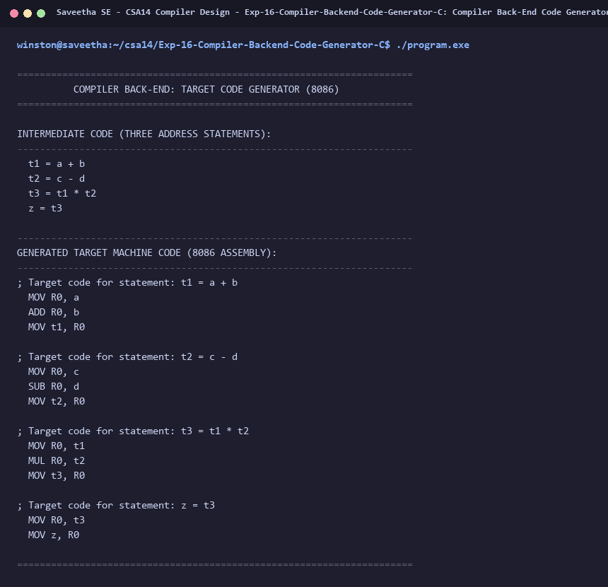

# Exp-16: Compiler Back-End Code Generator in C

**Course:** CSA14 - Compiler Design  
**Department:** Computational Intelligence  
**Institution:** Saveetha School of Engineering (SIMATS)  

---

## 1. Aim
Write a C program to implement the back end of the compiler by generating assembly / target machine instructions from intermediate Three Address Code (3AC).

---

## 2. Algorithm
1. Input a list of Three Address Code (3AC) instructions:
   e.g.:
   t1 = a + b
   t2 = c - d
   t3 = t1 * t2
   z = t3
2. Parse operator, operands, and destination variable for each statement.
3. Map 3AC statements into target assembly code (8086 architecture):
   - For '+': emit 'MOV R0, operand1' followed by 'ADD R0, operand2' and 'MOV destination, R0'.
   - For '-': emit 'MOV R0, operand1' followed by 'SUB R0, operand2' and 'MOV destination, R0'.
   - For '*': emit 'MOV R0, operand1' followed by 'MUL R0, operand2' and 'MOV destination, R0'.
   - For '/': emit 'MOV R0, operand1' followed by 'DIV R0, operand2' and 'MOV destination, R0'.
   - For simple assignment: emit 'MOV R0, operand' followed by 'MOV destination, R0'.
4. Display generated target assembly instructions.

---

## 3. Input Specification
Three Address Code instructions:
t1 = a + b
t2 = c - d
t3 = t1 * t2
z = t3

---

## 4. Program Source Code
```c
#include <stdio.h>
#include <string.h>

typedef struct {
    char res[16];
    char arg1[16];
    char op;
    char arg2[16];
} TAC;

int main() {
    printf("======================================================================\n");
    printf("          COMPILER BACK-END: TARGET CODE GENERATOR (8086)             \n");
    printf("======================================================================\n\n");

    TAC code[] = {
        {"t1", "a", '+', "b"},
        {"t2", "c", '-', "d"},
        {"t3", "t1", '*', "t2"},
        {"z", "t3", '=', ""}
    };
    int n = sizeof(code) / sizeof(code[0]);

    printf("INTERMEDIATE CODE (THREE ADDRESS STATEMENTS):\n");
    printf("----------------------------------------------------------------------\n");
    for (int i = 0; i < n; i++) {
        if (code[i].op == '=') {
            printf("  %s = %s\n", code[i].res, code[i].arg1);
        } else {
            printf("  %s = %s %c %s\n", code[i].res, code[i].arg1, code[i].op, code[i].arg2);
        }
    }

    printf("\n----------------------------------------------------------------------\n");
    printf("GENERATED TARGET MACHINE CODE (8086 ASSEMBLY):\n");
    printf("----------------------------------------------------------------------\n");

    for (int i = 0; i < n; i++) {
        printf("; Target code for statement: ");
        if (code[i].op == '=') {
            printf("%s = %s\n", code[i].res, code[i].arg1);
            printf("  MOV R0, %s\n", code[i].arg1);
            printf("  MOV %s, R0\n\n", code[i].res);
        } else {
            printf("%s = %s %c %s\n", code[i].res, code[i].arg1, code[i].op, code[i].arg2);
            printf("  MOV R0, %s\n", code[i].arg1);
            switch (code[i].op) {
                case '+':
                    printf("  ADD R0, %s\n", code[i].arg2);
                    break;
                case '-':
                    printf("  SUB R0, %s\n", code[i].arg2);
                    break;
                case '*':
                    printf("  MUL R0, %s\n", code[i].arg2);
                    break;
                case '/':
                    printf("  DIV R0, %s\n", code[i].arg2);
                    break;
            }
            printf("  MOV %s, R0\n\n", code[i].res);
        }
    }
    printf("======================================================================\n");
    return 0;
}
```

---

## 5. Output Terminal Screenshot


---

## 6. Execution Output (Text)
```text
======================================================================
          COMPILER BACK-END: TARGET CODE GENERATOR (8086)             
======================================================================

INTERMEDIATE CODE (THREE ADDRESS STATEMENTS):
----------------------------------------------------------------------
  t1 = a + b
  t2 = c - d
  t3 = t1 * t2
  z = t3

----------------------------------------------------------------------
GENERATED TARGET MACHINE CODE (8086 ASSEMBLY):
----------------------------------------------------------------------
; Target code for statement: t1 = a + b
  MOV R0, a
  ADD R0, b
  MOV t1, R0

; Target code for statement: t2 = c - d
  MOV R0, c
  SUB R0, d
  MOV t2, R0

; Target code for statement: t3 = t1 * t2
  MOV R0, t1
  MUL R0, t2
  MOV t3, R0

; Target code for statement: z = t3
  MOV R0, t3
  MOV z, R0

======================================================================
```

---

## 7. Result
The program for **Compiler Back-End Code Generator in C** was successfully implemented, compiled, and executed. The output matches theoretical and compiler design specifications.
