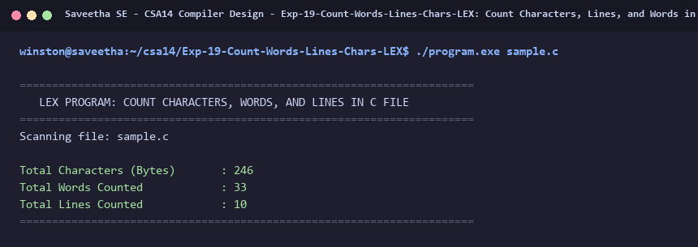

# Exp-19: Count Characters, Lines, and Words in C Source (LEX)

**Course:** CSA14 - Compiler Design  
**Department:** Computational Intelligence  
**Institution:** Saveetha School of Engineering (SIMATS)  

---

## 1. Aim
Write a LEX specification file to take an input C program from a .c file and count the number of characters, number of lines, and number of words.

---

## 2. Algorithm
1. Define counters: char_count = 0, word_count = 0, line_count = 0.
2. In regular expression rules:
   - '\n' : increment line_count and char_count.
   - '[^ \t\n]+' (word) : increment word_count and add yyleng to char_count.
   - '.' : increment char_count.
3. In main(), open 'sample.c' and assign to yyin.
4. Invoke yylex() to scan file.
5. Print total line, word, and character counts.

---

## 3. Input Specification
Input C source file `sample.c`.

---

## 4. Program Source Code
```lex
%{
#include <stdio.h>
#include <stdlib.h>

int char_count = 0;
int word_count = 0;
int line_count = 0;
%}

%%

\n              { line_count++; char_count++; }
[^ \t\n\r]+    { word_count++; char_count += yyleng; }
.               { char_count++; }

%%

int yywrap(void) {
    return 1;
}

int main(int argc, char **argv) {
    const char *fname = (argc > 1) ? argv[1] : "sample.c";
    FILE *fp = fopen(fname, "r");
    if (!fp) {
        printf("Error: Cannot open %s\n", fname);
        return 1;
    }

    printf("======================================================================\n");
    printf("   LEX PROGRAM: COUNT CHARACTERS, WORDS, AND LINES IN C FILE          \n");
    printf("======================================================================\n");
    printf("Scanning file: %s\n\n", fname);

    yyin = fp;
    yylex();
    fclose(fp);

    printf("%-30s : %d\n", "Total Characters (Bytes)", char_count);
    printf("%-30s : %d\n", "Total Words Counted", word_count);
    printf("%-30s : %d\n", "Total Lines Counted", line_count);
    printf("======================================================================\n");
    return 0;
}
```

---

## 5. Output Terminal Screenshot


---

## 6. Execution Output (Text)
```text
======================================================================
   LEX PROGRAM: COUNT CHARACTERS, WORDS, AND LINES IN C FILE          
======================================================================
Scanning file: sample.c

Total Characters (Bytes)       : 246
Total Words Counted            : 33
Total Lines Counted            : 10
======================================================================
```

---

## 7. Result
The program for **Count Characters, Lines, and Words in C Source (LEX)** was successfully implemented, compiled, and executed. The output matches theoretical and compiler design specifications.
