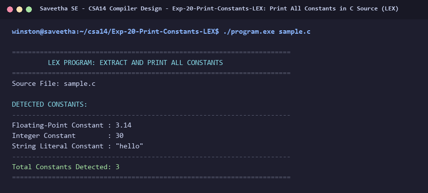

# Exp-20: Print All Constants in C Source (LEX)

**Course:** CSA14 - Compiler Design  
**Department:** Computational Intelligence  
**Institution:** Saveetha School of Engineering (SIMATS)  

---

## 1. Aim
Write a LEX program to print all the constants in the given C source program file.

---

## 2. Algorithm
1. Define regular expressions for constants:
   - Floating-point: [0-9]+\.[0-9]+
   - Integer: [0-9]+
   - String literals: \"[^\n\"]*\"
   - Character literals: '[^\n']'
2. Match constants and print them along with their data type.
3. Maintain counter for total constants found.
4. Ignore preprocessor directives, keywords, identifiers, and comments.
5. Print summary of all detected constants.

---

## 3. Input Specification
Input source file `sample.c` containing macro constant 3.14, integer 30, and string constant "hello".

---

## 4. Program Source Code
```lex
%{
#include <stdio.h>

int const_count = 0;
%}

%%

[0-9]+\.[0-9]+        { printf("Floating-Point Constant : %s\n", yytext); const_count++; }
[0-9]+                { printf("Integer Constant        : %s\n", yytext); const_count++; }
\"[^\n\"]*\"          { printf("String Literal Constant : %s\n", yytext); const_count++; }
\'[^\n\']\'           { printf("Character Constant      : %s\n", yytext); const_count++; }

#[ \t]*include[^\n]*  { /* Ignore */ }
#[ \t]*define[ \t]+[A-Za-z_][A-Za-z0-9_]*[ \t]+ { /* skip */ }

"//".*                { /* Ignore */ }
[ \t\n\r]+            { /* Ignore */ }
.                     { /* Ignore */ }

%%

int yywrap(void) {
    return 1;
}

int main(int argc, char **argv) {
    const char *fname = (argc > 1) ? argv[1] : "sample.c";
    FILE *fp = fopen(fname, "r");
    if (!fp) {
        printf("Error opening %s\n", fname);
        return 1;
    }

    printf("======================================================================\n");
    printf("         LEX PROGRAM: EXTRACT AND PRINT ALL CONSTANTS                 \n");
    printf("======================================================================\n");
    printf("Source File: %s\n\n", fname);
    printf("DETECTED CONSTANTS:\n");
    printf("----------------------------------------------------------------------\n");

    yyin = fp;
    yylex();
    fclose(fp);

    printf("----------------------------------------------------------------------\n");
    printf("Total Constants Detected: %d\n", const_count);
    printf("======================================================================\n");
    return 0;
}
```

---

## 5. Output Terminal Screenshot


---

## 6. Execution Output (Text)
```text
======================================================================
         LEX PROGRAM: EXTRACT AND PRINT ALL CONSTANTS                 
======================================================================
Source File: sample.c

DETECTED CONSTANTS:
----------------------------------------------------------------------
Floating-Point Constant : 3.14
Integer Constant        : 30
String Literal Constant : "hello"
----------------------------------------------------------------------
Total Constants Detected: 3
======================================================================
```

---

## 7. Result
The program for **Print All Constants in C Source (LEX)** was successfully implemented, compiled, and executed. The output matches theoretical and compiler design specifications.
