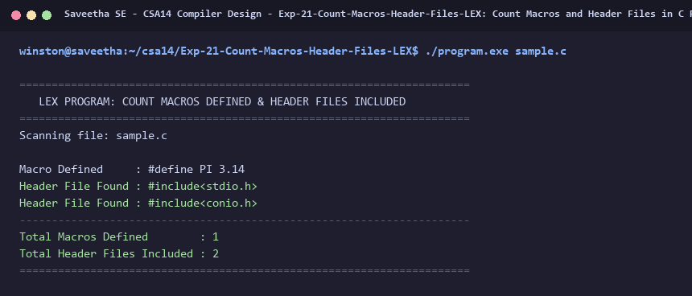

# Exp-21: Count Macros and Header Files in C Program (LEX)

**Course:** CSA14 - Compiler Design  
**Department:** Computational Intelligence  
**Institution:** Saveetha School of Engineering (SIMATS)  

---

## 1. Aim
Write a LEX program to count the number of Macros defined and header files included in the C program.

---

## 2. Algorithm
1. Define regular expressions:
   - Macros: '#[ \t]*define[ \t]+[^\n\r]+'
   - Headers: '#[ \t]*include[ \t]*[<\"][^>\n\r\"]+[>\"]'
2. Maintain counters: macro_count = 0, header_count = 0.
3. Upon matching macro, print macro definition and increment macro_count.
4. Upon matching header, print header file name and increment header_count.
5. Ignore other C program code.
6. Print total macros and headers counted.

---

## 3. Input Specification
Input source file `sample.c`.

---

## 4. Program Source Code
```lex
%{
#include <stdio.h>

int macro_count = 0;
int header_count = 0;
%}

%%

#[ \t]*"define"[ \t]+[^\n\r]+        { 
                                        printf("Macro Defined     : %s\n", yytext); 
                                        macro_count++; 
                                    }

#[ \t]*"include"[ \t]*[<"][^>\n\r"]+[>"] { 
                                        printf("Header File Found : %s\n", yytext); 
                                        header_count++; 
                                    }

"//".*                              { /* Ignore single-line comments */ }
"/*"([^*]|\*+[^*/])*\*+"/"          { /* Ignore multi-line comments */ }

\n                                  { /* Ignore */ }
[ \t]+                              { /* Ignore */ }
.                                   { /* Ignore */ }

%%

int yywrap(void) {
    return 1;
}

int main(int argc, char **argv) {
    const char *fname = (argc > 1) ? argv[1] : "sample.c";
    FILE *fp = fopen(fname, "r");
    if (!fp) {
        printf("Error: Cannot open %s\n", fname);
        return 1;
    }

    printf("======================================================================\n");
    printf("   LEX PROGRAM: COUNT MACROS DEFINED & HEADER FILES INCLUDED          \n");
    printf("======================================================================\n");
    printf("Scanning file: %s\n\n", fname);

    yyin = fp;
    yylex();
    fclose(fp);

    printf("----------------------------------------------------------------------\n");
    printf("Total Macros Defined        : %d\n", macro_count);
    printf("Total Header Files Included : %d\n", header_count);
    printf("======================================================================\n");
    return 0;
}
```

---

## 5. Output Terminal Screenshot


---

## 6. Execution Output (Text)
```text
======================================================================
   LEX PROGRAM: COUNT MACROS DEFINED & HEADER FILES INCLUDED          
======================================================================
Scanning file: sample.c

Macro Defined     : #define PI 3.14   
Header File Found : #include<stdio.h>
Header File Found : #include<conio.h>
----------------------------------------------------------------------
Total Macros Defined        : 1
Total Header Files Included : 2
======================================================================
```

---

## 7. Result
The program for **Count Macros and Header Files in C Program (LEX)** was successfully implemented, compiled, and executed. The output matches theoretical and compiler design specifications.
