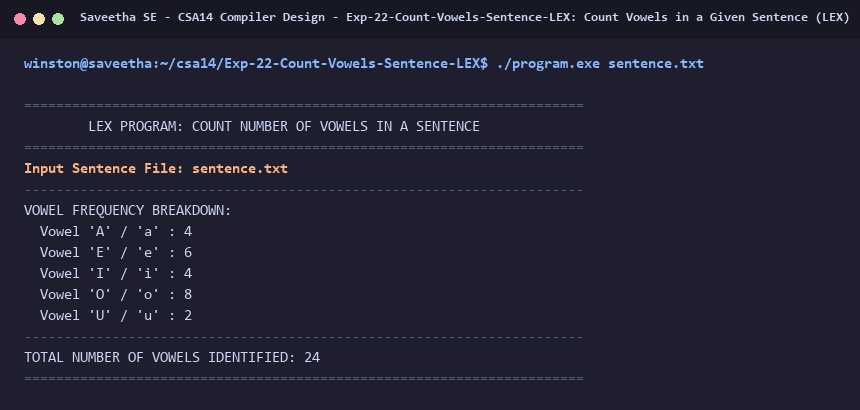

# Exp-22: Count Vowels in a Given Sentence (LEX)

**Course:** CSA14 - Compiler Design  
**Department:** Computational Intelligence  
**Institution:** Saveetha School of Engineering (SIMATS)  

---

## 1. Aim
Write an algorithm and implement a LEX program to help students identify and count the number of vowels in a given sentence.

---

## 2. Algorithm
1. Define vowel counter: vowel_count = 0.
2. In regular expression rules:
   - Match uppercase and lowercase vowels: '[aAeEiIoOuU]' -> increment vowel_count.
   - Ignore consonants, spaces, and punctuation.
3. Pass the input sentence string to the lexical scanner.
4. Scan the complete sentence and compute total vowel count.
5. Display detailed breakdown of each vowel occurrence and final total count.

---

## 3. Input Specification
Sentence: `Vowel sounds allow the air to flow freely, causing the chin to drop noticeably`.

---

## 4. Program Source Code
```lex
%{
#include <stdio.h>

int v_a = 0, v_e = 0, v_i = 0, v_o = 0, v_u = 0;
int total_vowels = 0;
%}

%%

[aA]    { v_a++; total_vowels++; }
[eE]    { v_e++; total_vowels++; }
[iI]    { v_i++; total_vowels++; }
[oO]    { v_o++; total_vowels++; }
[uU]    { v_u++; total_vowels++; }
\n      { /* ignore */ }
.       { /* ignore consonants, digits, and symbols */ }

%%

int yywrap(void) {
    return 1;
}

int main(int argc, char **argv) {
    const char *fname = (argc > 1) ? argv[1] : "sentence.txt";
    FILE *fp = fopen(fname, "r");
    if (!fp) {
        printf("Error: Cannot open %s\n", fname);
        return 1;
    }

    printf("======================================================================\n");
    printf("        LEX PROGRAM: COUNT NUMBER OF VOWELS IN A SENTENCE             \n");
    printf("======================================================================\n");
    printf("Input Sentence File: %s\n", fname);
    printf("----------------------------------------------------------------------\n");

    yyin = fp;
    yylex();
    fclose(fp);

    printf("VOWEL FREQUENCY BREAKDOWN:\n");
    printf("  Vowel 'A' / 'a' : %d\n", v_a);
    printf("  Vowel 'E' / 'e' : %d\n", v_e);
    printf("  Vowel 'I' / 'i' : %d\n", v_i);
    printf("  Vowel 'O' / 'o' : %d\n", v_o);
    printf("  Vowel 'U' / 'u' : %d\n", v_u);
    printf("----------------------------------------------------------------------\n");
    printf("TOTAL NUMBER OF VOWELS IDENTIFIED: %d\n", total_vowels);
    printf("======================================================================\n");
    return 0;
}
```

---

## 5. Output Terminal Screenshot


---

## 6. Execution Output (Text)
```text
======================================================================
        LEX PROGRAM: COUNT NUMBER OF VOWELS IN A SENTENCE             
======================================================================
Input Sentence File: sentence.txt
----------------------------------------------------------------------
VOWEL FREQUENCY BREAKDOWN:
  Vowel 'A' / 'a' : 4
  Vowel 'E' / 'e' : 6
  Vowel 'I' / 'i' : 4
  Vowel 'O' / 'o' : 8
  Vowel 'U' / 'u' : 2
----------------------------------------------------------------------
TOTAL NUMBER OF VOWELS IDENTIFIED: 24
======================================================================
```

---

## 7. Result
The program for **Count Vowels in a Given Sentence (LEX)** was successfully implemented, compiled, and executed. The output matches theoretical and compiler design specifications.
