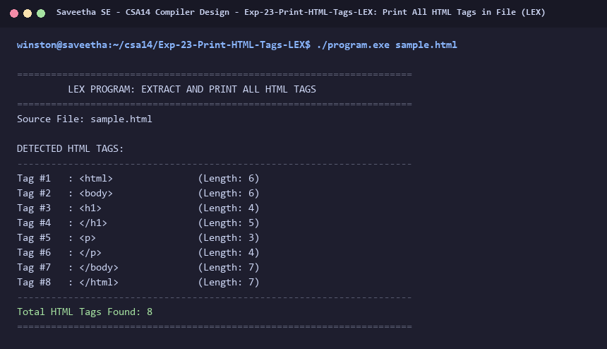

# Exp-23: Print All HTML Tags in File (LEX)

**Course:** CSA14 - Compiler Design  
**Department:** Computational Intelligence  
**Institution:** Saveetha School of Engineering (SIMATS)  

---

## 1. Aim
Write a LEX program to print all HTML tags in the input file.

---

## 2. Algorithm
1. Define regular expression for HTML tags: '<[^>]+>'
2. Match tags and print each detected tag with index and category.
3. Increment tag counter.
4. Ignore regular content text, spaces, and newlines.
5. Display summary count of detected HTML tags.

---

## 3. Input Specification
Input HTML file `sample.html`.

---

## 4. Program Source Code
```lex
%{
#include <stdio.h>

int tag_count = 0;
%}

%%

"<"[^>]+">"          { 
                        printf("Tag #%-3d : %-20s (Length: %d)\n", ++tag_count, yytext, yyleng); 
                     }
\n                   { /* Ignore */ }
.                    { /* Ignore text */ }

%%

int yywrap(void) {
    return 1;
}

int main(int argc, char **argv) {
    const char *fname = (argc > 1) ? argv[1] : "sample.html";
    FILE *fp = fopen(fname, "r");
    if (!fp) {
        printf("Error: Cannot open %s\n", fname);
        return 1;
    }

    printf("======================================================================\n");
    printf("         LEX PROGRAM: EXTRACT AND PRINT ALL HTML TAGS                 \n");
    printf("======================================================================\n");
    printf("Source File: %s\n\n", fname);
    printf("DETECTED HTML TAGS:\n");
    printf("----------------------------------------------------------------------\n");

    yyin = fp;
    yylex();
    fclose(fp);

    printf("----------------------------------------------------------------------\n");
    printf("Total HTML Tags Found: %d\n", tag_count);
    printf("======================================================================\n");
    return 0;
}
```

---

## 5. Output Terminal Screenshot


---

## 6. Execution Output (Text)
```text
======================================================================
         LEX PROGRAM: EXTRACT AND PRINT ALL HTML TAGS                 
======================================================================
Source File: sample.html

DETECTED HTML TAGS:
----------------------------------------------------------------------
Tag #1   : <html>               (Length: 6)
Tag #2   : <body>               (Length: 6)
Tag #3   : <h1>                 (Length: 4)
Tag #4   : </h1>                (Length: 5)
Tag #5   : <p>                  (Length: 3)
Tag #6   : </p>                 (Length: 4)
Tag #7   : </body>              (Length: 7)
Tag #8   : </html>              (Length: 7)
----------------------------------------------------------------------
Total HTML Tags Found: 8
======================================================================
```

---

## 7. Result
The program for **Print All HTML Tags in File (LEX)** was successfully implemented, compiled, and executed. The output matches theoretical and compiler design specifications.
