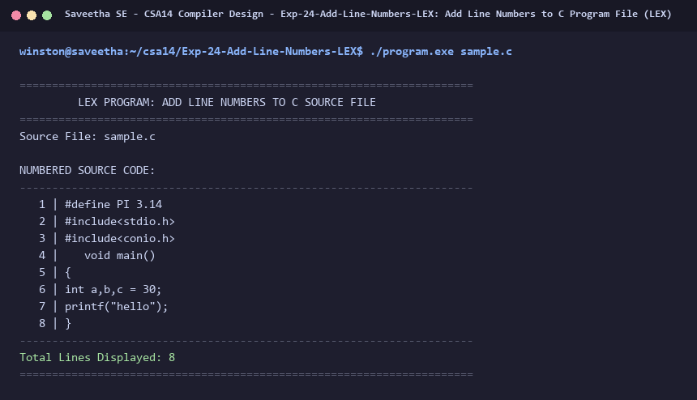

# Exp-24: Add Line Numbers to C Program File (LEX)

**Course:** CSA14 - Compiler Design  
**Department:** Computational Intelligence  
**Institution:** Saveetha School of Engineering (SIMATS)  

---

## 1. Aim
Write a LEX program which adds line numbers to the given C program file and displays the same in the standard output.

---

## 2. Algorithm
1. Initialize line counter: line_num = 1.
2. In regular expression rules:
   - '.*\n' : print line_num formatted, print line text, increment line_num.
   - '.+'   : handle last line if without trailing newline.
3. Open target source file and assign to yyin.
4. Scan and display all lines with line numbers.
5. Print total lines displayed.

---

## 3. Input Specification
Input C file `sample.c`.

---

## 4. Program Source Code
```lex
%{
#include <stdio.h>

int line_number = 1;
%}

%%

.*\n    { printf("%4d | %s", line_number++, yytext); }
.+      { printf("%4d | %s\n", line_number++, yytext); }

%%

int yywrap(void) {
    return 1;
}

int main(int argc, char **argv) {
    const char *fname = (argc > 1) ? argv[1] : "sample.c";
    FILE *fp = fopen(fname, "r");
    if (!fp) {
        printf("Error: Cannot open %s\n", fname);
        return 1;
    }

    printf("======================================================================\n");
    printf("         LEX PROGRAM: ADD LINE NUMBERS TO C SOURCE FILE               \n");
    printf("======================================================================\n");
    printf("Source File: %s\n\n", fname);
    printf("NUMBERED SOURCE CODE:\n");
    printf("----------------------------------------------------------------------\n");

    yyin = fp;
    yylex();
    fclose(fp);

    printf("----------------------------------------------------------------------\n");
    printf("Total Lines Displayed: %d\n", line_number - 1);
    printf("======================================================================\n");
    return 0;
}
```

---

## 5. Output Terminal Screenshot


---

## 6. Execution Output (Text)
```text
======================================================================
         LEX PROGRAM: ADD LINE NUMBERS TO C SOURCE FILE               
======================================================================
Source File: sample.c

NUMBERED SOURCE CODE:
----------------------------------------------------------------------
   1 | #define PI 3.14   
   2 | #include<stdio.h> 
   3 | #include<conio.h>
   4 |    void main()
   5 | {
   6 | int a,b,c = 30;
   7 | printf("hello");
   8 | }
----------------------------------------------------------------------
Total Lines Displayed: 8
======================================================================
```

---

## 7. Result
The program for **Add Line Numbers to C Program File (LEX)** was successfully implemented, compiled, and executed. The output matches theoretical and compiler design specifications.
