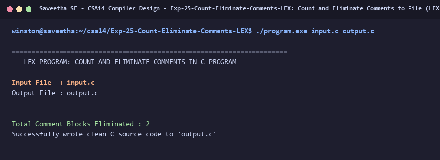

# Exp-25: Count and Eliminate Comments to File (LEX)

**Course:** CSA14 - Compiler Design  
**Department:** Computational Intelligence  
**Institution:** Saveetha School of Engineering (SIMATS)  

---

## 1. Aim
Write a LEX program to count the number of comment lines in a given C program, eliminate them, and write into another file.

---

## 2. Algorithm
1. Open input file in read mode and output file in write mode.
2. Direct non-comment characters to output file using fputc(yytext[0], yyout).
3. Detect single-line comments ('//.*') and multi-line comments ('/\*([^*]|\*+[^*/])*\*+/').
4. For each comment matched:
   - Increment comment counter.
   - Do not write to output file.
5. Print total comment count and confirm clean output generation.

---

## 3. Input Specification
Input file `input.c` containing single-line and multi-line comments.

---

## 4. Program Source Code
```lex
%{
#include <stdio.h>

int comment_count = 0;
%}

%%

"//".*                  { 
                            comment_count++; 
                        }

"/*"([^*]|\*+[^*/])*\*+"/" { 
                            comment_count++; 
                        }

.                       { fputc(yytext[0], yyout); }
\n                      { fputc('\n', yyout); }

%%

int yywrap(void) {
    return 1;
}

int main(int argc, char **argv) {
    const char *in_name = (argc > 1) ? argv[1] : "input.c";
    const char *out_name = (argc > 2) ? argv[2] : "output.c";

    FILE *fin = fopen(in_name, "r");
    if (!fin) {
        printf("Error opening %s\n", in_name);
        return 1;
    }

    FILE *fout = fopen(out_name, "w");
    if (!fout) {
        printf("Error opening %s\n", out_name);
        fclose(fin);
        return 1;
    }

    printf("======================================================================\n");
    printf("   LEX PROGRAM: COUNT AND ELIMINATE COMMENTS IN C PROGRAM             \n");
    printf("======================================================================\n");
    printf("Input File  : %s\n", in_name);
    printf("Output File : %s\n\n", out_name);

    yyin = fin;
    yyout = fout;
    yylex();

    fclose(fin);
    fclose(fout);

    printf("----------------------------------------------------------------------\n");
    printf("Total Comment Blocks Eliminated : %d\n", comment_count);
    printf("Successfully wrote clean C source code to '%s'\n", out_name);
    printf("======================================================================\n");
    return 0;
}
```

---

## 5. Output Terminal Screenshot


---

## 6. Execution Output (Text)
```text
======================================================================
   LEX PROGRAM: COUNT AND ELIMINATE COMMENTS IN C PROGRAM             
======================================================================
Input File  : input.c
Output File : output.c

----------------------------------------------------------------------
Total Comment Blocks Eliminated : 2
Successfully wrote clean C source code to 'output.c'
======================================================================
```

---

## 7. Result
The program for **Count and Eliminate Comments to File (LEX)** was successfully implemented, compiled, and executed. The output matches theoretical and compiler design specifications.
