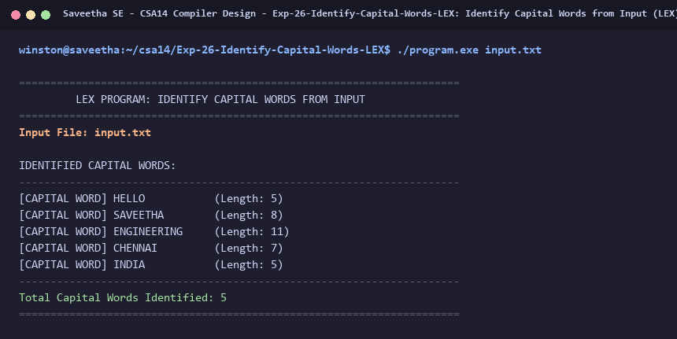

# Exp-26: Identify Capital Words from Input (LEX)

**Course:** CSA14 - Compiler Design  
**Department:** Computational Intelligence  
**Institution:** Saveetha School of Engineering (SIMATS)  

---

## 1. Aim
Write a LEX program to identify and display the capital words (words containing all uppercase letters) from the given input.

---

## 2. Algorithm
1. Define uppercase word token: '[A-Z]+'
2. Match capital words and print: '<word> is a Capital Word'.
3. Increment capital word counter.
4. Skip lowercase words, mixed words, numbers, and punctuation.
5. Print total count of identified capital words.

---

## 3. Input Specification
Input text: `HELLO world this is SAVEETHA school of ENGINEERING in CHENNAI INDIA`.

---

## 4. Program Source Code
```lex
%{
#include <stdio.h>

int cap_count = 0;
%}

%%

[A-Z]+      { 
                printf("[CAPITAL WORD] %-15s (Length: %d)\n", yytext, yyleng); 
                cap_count++; 
            }
[a-zA-Z]+   { /* Ignore */ }
\n          { /* Ignore */ }
.           { /* Ignore */ }

%%

int yywrap(void) {
    return 1;
}

int main(int argc, char **argv) {
    const char *fname = (argc > 1) ? argv[1] : "input.txt";
    FILE *fp = fopen(fname, "r");
    if (!fp) {
        printf("Error: Cannot open %s\n", fname);
        return 1;
    }

    printf("======================================================================\n");
    printf("         LEX PROGRAM: IDENTIFY CAPITAL WORDS FROM INPUT               \n");
    printf("======================================================================\n");
    printf("Input File: %s\n\n", fname);
    printf("IDENTIFIED CAPITAL WORDS:\n");
    printf("----------------------------------------------------------------------\n");

    yyin = fp;
    yylex();
    fclose(fp);

    printf("----------------------------------------------------------------------\n");
    printf("Total Capital Words Identified: %d\n", cap_count);
    printf("======================================================================\n");
    return 0;
}
```

---

## 5. Output Terminal Screenshot


---

## 6. Execution Output (Text)
```text
======================================================================
         LEX PROGRAM: IDENTIFY CAPITAL WORDS FROM INPUT               
======================================================================
Input File: input.txt

IDENTIFIED CAPITAL WORDS:
----------------------------------------------------------------------
[CAPITAL WORD] HELLO           (Length: 5)
[CAPITAL WORD] SAVEETHA        (Length: 8)
[CAPITAL WORD] ENGINEERING     (Length: 11)
[CAPITAL WORD] CHENNAI         (Length: 7)
[CAPITAL WORD] INDIA           (Length: 5)
----------------------------------------------------------------------
Total Capital Words Identified: 5
======================================================================
```

---

## 7. Result
The program for **Identify Capital Words from Input (LEX)** was successfully implemented, compiled, and executed. The output matches theoretical and compiler design specifications.
