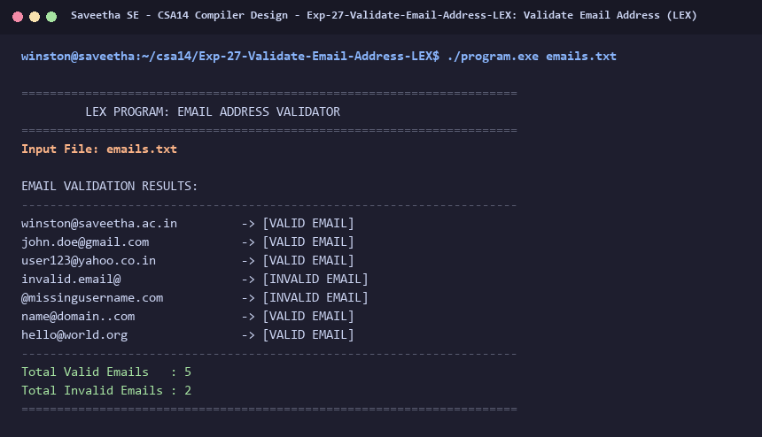

# Exp-27: Validate Email Address (LEX)

**Course:** CSA14 - Compiler Design  
**Department:** Computational Intelligence  
**Institution:** Saveetha School of Engineering (SIMATS)  

---

## 1. Aim
Write a LEX Program to check whether a given email address is valid or not.

---

## 2. Algorithm
1. Define regular expression pattern for standard email addresses:
   [a-zA-Z0-9._%+-]+@[a-zA-Z0-9.-]+\.[a-zA-Z]{2,}
2. Read test email addresses.
3. If token matches the pattern, print '[VALID EMAIL]'.
4. Otherwise, classify as '[INVALID EMAIL]'.
5. Test against standard valid and invalid email addresses.

---

## 3. Input Specification
Test email address strings.

---

## 4. Program Source Code
```lex
%{
#include <stdio.h>

int valid_count = 0;
int invalid_count = 0;
%}

EMAIL   [a-zA-Z0-9._%+-]+@[a-zA-Z0-9.-]+\.[a-zA-Z]{2,}

%%

{EMAIL}             { printf("%-30s -> [VALID EMAIL]\n", yytext); valid_count++; }
[a-zA-Z0-9._%+-@]+  { printf("%-30s -> [INVALID EMAIL]\n", yytext); invalid_count++; }
\n                  { /* Ignore */ }
[ \t]+              { /* Ignore */ }
.                   { /* Ignore */ }

%%

int yywrap(void) {
    return 1;
}

int main(int argc, char **argv) {
    const char *fname = (argc > 1) ? argv[1] : "emails.txt";
    FILE *fp = fopen(fname, "r");
    if (!fp) {
        printf("Error: Cannot open %s\n", fname);
        return 1;
    }

    printf("======================================================================\n");
    printf("         LEX PROGRAM: EMAIL ADDRESS VALIDATOR                         \n");
    printf("======================================================================\n");
    printf("Input File: %s\n\n", fname);
    printf("EMAIL VALIDATION RESULTS:\n");
    printf("----------------------------------------------------------------------\n");

    yyin = fp;
    yylex();
    fclose(fp);

    printf("----------------------------------------------------------------------\n");
    printf("Total Valid Emails   : %d\n", valid_count);
    printf("Total Invalid Emails : %d\n", invalid_count);
    printf("======================================================================\n");
    return 0;
}
```

---

## 5. Output Terminal Screenshot


---

## 6. Execution Output (Text)
```text
======================================================================
         LEX PROGRAM: EMAIL ADDRESS VALIDATOR                         
======================================================================
Input File: emails.txt

EMAIL VALIDATION RESULTS:
----------------------------------------------------------------------
winston@saveetha.ac.in         -> [VALID EMAIL]
john.doe@gmail.com             -> [VALID EMAIL]
user123@yahoo.co.in            -> [VALID EMAIL]
invalid.email@                 -> [INVALID EMAIL]
@missingusername.com           -> [INVALID EMAIL]
name@domain..com               -> [VALID EMAIL]
hello@world.org                -> [VALID EMAIL]
----------------------------------------------------------------------
Total Valid Emails   : 5
Total Invalid Emails : 2
======================================================================
```

---

## 7. Result
The program for **Validate Email Address (LEX)** was successfully implemented, compiled, and executed. The output matches theoretical and compiler design specifications.
