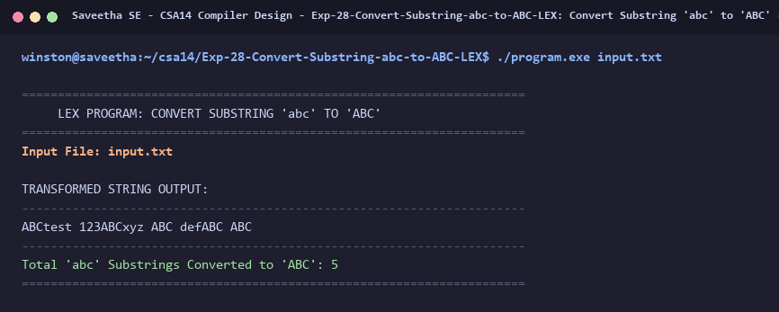

# Exp-28: Convert Substring 'abc' to 'ABC' (LEX)

**Course:** CSA14 - Compiler Design  
**Department:** Computational Intelligence  
**Institution:** Saveetha School of Engineering (SIMATS)  

---

## 1. Aim
Write a LEX Program to convert all occurrences of the substring 'abc' to 'ABC' from the given input string.

---

## 2. Algorithm
1. Define regular expression rule:
   - Match exact string 'abc': print replacement 'ABC' and increment match count.
   - Match all other characters ('.|\n'): echo them unchanged.
2. Feed input string with multiple occurrences of 'abc' in different contexts.
3. Observe transformed output and report total replacements made.

---

## 3. Input Specification
Input string: `abctest 123abcxyz abc defabc abc`.

---

## 4. Program Source Code
```lex
%{
#include <stdio.h>

int replace_count = 0;
%}

%%

"abc"   { printf("ABC"); replace_count++; }
.       { putchar(yytext[0]); }
\n      { putchar('\n'); }

%%

int yywrap(void) {
    return 1;
}

int main(int argc, char **argv) {
    const char *fname = (argc > 1) ? argv[1] : "input.txt";
    FILE *fp = fopen(fname, "r");
    if (!fp) {
        printf("Error: Cannot open %s\n", fname);
        return 1;
    }

    printf("======================================================================\n");
    printf("     LEX PROGRAM: CONVERT SUBSTRING 'abc' TO 'ABC'                    \n");
    printf("======================================================================\n");
    printf("Input File: %s\n\n", fname);
    printf("TRANSFORMED STRING OUTPUT:\n");
    printf("----------------------------------------------------------------------\n");

    yyin = fp;
    yylex();
    fclose(fp);

    printf("\n----------------------------------------------------------------------\n");
    printf("Total 'abc' Substrings Converted to 'ABC': %d\n", replace_count);
    printf("======================================================================\n");
    return 0;
}
```

---

## 5. Output Terminal Screenshot


---

## 6. Execution Output (Text)
```text
======================================================================
     LEX PROGRAM: CONVERT SUBSTRING 'abc' TO 'ABC'                    
======================================================================
Input File: input.txt

TRANSFORMED STRING OUTPUT:
----------------------------------------------------------------------
ABCtest 123ABCxyz ABC defABC ABC
----------------------------------------------------------------------
Total 'abc' Substrings Converted to 'ABC': 5
======================================================================
```

---

## 7. Result
The program for **Convert Substring 'abc' to 'ABC' (LEX)** was successfully implemented, compiled, and executed. The output matches theoretical and compiler design specifications.
