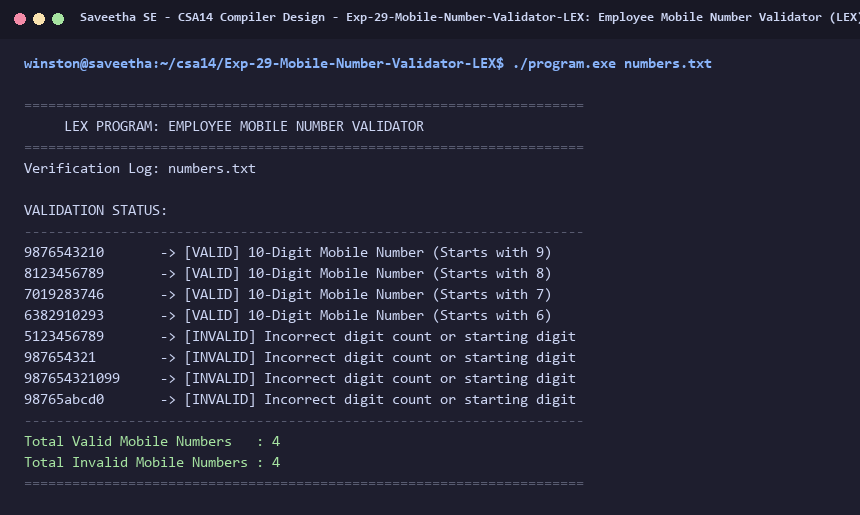

# Exp-29: Employee Mobile Number Validator (LEX)

**Course:** CSA14 - Compiler Design  
**Department:** Computational Intelligence  
**Institution:** Saveetha School of Engineering (SIMATS)  

---

## 1. Aim
Implement a LEX program to check whether an employee mobile number is valid or not (10-digit Indian standard starting with digits 6, 7, 8, or 9).

---

## 2. Algorithm
1. Define regular expression pattern for valid mobile number:
   ^[6-9][0-9]{9}$
2. Read mobile number candidates line by line.
3. If number matches 10 digits starting with [6-9], classify as [VALID MOBILE NUMBER].
4. If length != 10 or starts with [0-5] or contains non-digits, classify as [INVALID MOBILE NUMBER].
5. Display detailed verification log for organization records.

---

## 3. Input Specification
List of employee phone numbers in `numbers.txt`.

---

## 4. Program Source Code
```lex
%{
#include <stdio.h>

int valid_mob = 0;
int invalid_mob = 0;
%}

MOBILE_VALID   [6-9][0-9]{9}
INVALID_TOKEN  [a-zA-Z0-9]+

%%

^{MOBILE_VALID}$    { printf("%-16s -> [VALID] 10-Digit Mobile Number (Starts with %c)\n", yytext, yytext[0]); valid_mob++; }
^{INVALID_TOKEN}$   { printf("%-16s -> [INVALID] Incorrect digit count or starting digit\n", yytext); invalid_mob++; }
\n                  { /* Ignore */ }
[ \t]+              { /* Ignore */ }
.                   { /* Ignore */ }

%%

int yywrap(void) {
    return 1;
}

int main(int argc, char **argv) {
    const char *fname = (argc > 1) ? argv[1] : "numbers.txt";
    FILE *fp = fopen(fname, "r");
    if (!fp) {
        printf("Error: Cannot open %s\n", fname);
        return 1;
    }

    printf("======================================================================\n");
    printf("     LEX PROGRAM: EMPLOYEE MOBILE NUMBER VALIDATOR                    \n");
    printf("======================================================================\n");
    printf("Verification Log: %s\n\n", fname);
    printf("VALIDATION STATUS:\n");
    printf("----------------------------------------------------------------------\n");

    yyin = fp;
    yylex();
    fclose(fp);

    printf("----------------------------------------------------------------------\n");
    printf("Total Valid Mobile Numbers   : %d\n", valid_mob);
    printf("Total Invalid Mobile Numbers : %d\n", invalid_mob);
    printf("======================================================================\n");
    return 0;
}
```

---

## 5. Output Terminal Screenshot


---

## 6. Execution Output (Text)
```text
======================================================================
     LEX PROGRAM: EMPLOYEE MOBILE NUMBER VALIDATOR                    
======================================================================
Verification Log: numbers.txt

VALIDATION STATUS:
----------------------------------------------------------------------
9876543210       -> [VALID] 10-Digit Mobile Number (Starts with 9)
8123456789       -> [VALID] 10-Digit Mobile Number (Starts with 8)
7019283746       -> [VALID] 10-Digit Mobile Number (Starts with 7)
6382910293       -> [VALID] 10-Digit Mobile Number (Starts with 6)
5123456789       -> [INVALID] Incorrect digit count or starting digit
987654321        -> [INVALID] Incorrect digit count or starting digit
987654321099     -> [INVALID] Incorrect digit count or starting digit
98765abcd0       -> [INVALID] Incorrect digit count or starting digit
----------------------------------------------------------------------
Total Valid Mobile Numbers   : 4
Total Invalid Mobile Numbers : 4
======================================================================
```

---

## 7. Result
The program for **Employee Mobile Number Validator (LEX)** was successfully implemented, compiled, and executed. The output matches theoretical and compiler design specifications.
