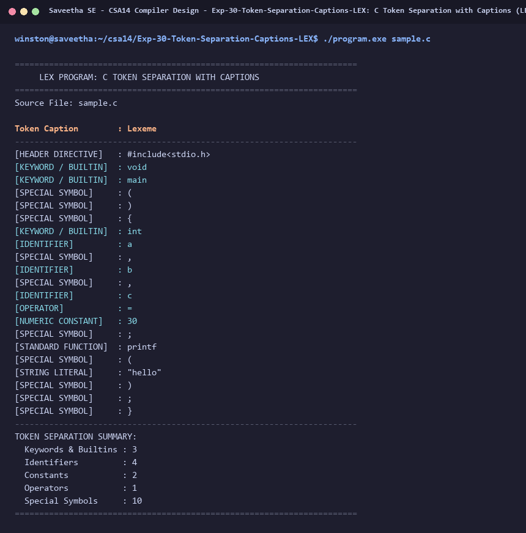

# Exp-30: C Token Separation with Captions (LEX)

**Course:** CSA14 - Compiler Design  
**Department:** Computational Intelligence  
**Institution:** Saveetha School of Engineering (SIMATS)  

---

## 1. Aim
Implement Lexical Analyzer using LEX/FLEX to separate tokens in the given C program and display them with appropriate captions.

---

## 2. Algorithm
1. Define regular expressions for lexical categories:
   - Header / Preprocessor: #[ \t]*include[ \t]*[<\"][^>\n\r\"]+[>\"]
   - Keywords: auto|break|case|char|const|continue|default|do|double|else|enum|extern|float|for|goto|if|int|long|register|return|short|signed|sizeof|static|struct|switch|typedef|union|unsigned|void|volatile|while
   - Identifiers: [a-zA-Z_][a-zA-Z0-9_]*
   - Constants: [0-9]+(\.[0-9]+)? or \"[^\"\n]*\"
   - Operators: [+\-*/%=<>!&|^]
   - Special Symbols / Delimiters: [;(),{}\[\]]
2. Match tokens and output each lexeme with its corresponding Caption.
3. Print summary table with token category counts.

---

## 3. Input Specification
Input source file `sample.c`.

---

## 4. Program Source Code
```lex
%{
#include <stdio.h>

int kw_cnt = 0, id_cnt = 0, const_cnt = 0, op_cnt = 0, sym_cnt = 0;
%}

%%

#[ \t]*"include"[ \t]*[<"][^>\n\r"]+[>"] { 
    printf("%-20s : %s\n", "[HEADER DIRECTIVE]", yytext); 
}

"void"|"int"|"char"|"float"|"double"|"return"|"main" {
    printf("%-20s : %s\n", "[KEYWORD / BUILTIN]", yytext);
    kw_cnt++;
}

"printf" {
    printf("%-20s : %s\n", "[STANDARD FUNCTION]", yytext);
    id_cnt++;
}

[0-9]+(\.[0-9]+)? {
    printf("%-20s : %s\n", "[NUMERIC CONSTANT]", yytext);
    const_cnt++;
}

\"[^\n\"]*\" {
    printf("%-20s : %s\n", "[STRING LITERAL]", yytext);
    const_cnt++;
}

[a-zA-Z_][a-zA-Z0-9_]* {
    printf("%-20s : %s\n", "[IDENTIFIER]", yytext);
    id_cnt++;
}

"="|"+"|"-"|"*"|"/" {
    printf("%-20s : %s\n", "[OPERATOR]", yytext);
    op_cnt++;
}

[;(),{}] {
    printf("%-20s : %s\n", "[SPECIAL SYMBOL]", yytext);
    sym_cnt++;
}

\n         { /* Ignore */ }
[ \t]+     { /* Ignore */ }
.          { /* Ignore */ }

%%

int yywrap(void) {
    return 1;
}

int main(int argc, char **argv) {
    const char *fname = (argc > 1) ? argv[1] : "sample.c";
    FILE *fp = fopen(fname, "r");
    if (!fp) {
        printf("Error: Cannot open %s\n", fname);
        return 1;
    }

    printf("======================================================================\n");
    printf("     LEX PROGRAM: C TOKEN SEPARATION WITH CAPTIONS                    \n");
    printf("======================================================================\n");
    printf("Source File: %s\n\n", fname);
    printf("%-20s : %s\n", "Token Caption", "Lexeme");
    printf("----------------------------------------------------------------------\n");

    yyin = fp;
    yylex();
    fclose(fp);

    printf("----------------------------------------------------------------------\n");
    printf("TOKEN SEPARATION SUMMARY:\n");
    printf("  Keywords & Builtins : %d\n", kw_cnt);
    printf("  Identifiers         : %d\n", id_cnt);
    printf("  Constants           : %d\n", const_cnt);
    printf("  Operators           : %d\n", op_cnt);
    printf("  Special Symbols     : %d\n", sym_cnt);
    printf("======================================================================\n");
    return 0;
}
```

---

## 5. Output Terminal Screenshot


---

## 6. Execution Output (Text)
```text
======================================================================
     LEX PROGRAM: C TOKEN SEPARATION WITH CAPTIONS                    
======================================================================
Source File: sample.c

Token Caption        : Lexeme
----------------------------------------------------------------------
[HEADER DIRECTIVE]   : #include<stdio.h>
[KEYWORD / BUILTIN]  : void
[KEYWORD / BUILTIN]  : main
[SPECIAL SYMBOL]     : (
[SPECIAL SYMBOL]     : )
[SPECIAL SYMBOL]     : {
[KEYWORD / BUILTIN]  : int
[IDENTIFIER]         : a
[SPECIAL SYMBOL]     : ,
[IDENTIFIER]         : b
[SPECIAL SYMBOL]     : ,
[IDENTIFIER]         : c
[OPERATOR]           : =
[NUMERIC CONSTANT]   : 30
[SPECIAL SYMBOL]     : ;
[STANDARD FUNCTION]  : printf
[SPECIAL SYMBOL]     : (
[STRING LITERAL]     : "hello"
[SPECIAL SYMBOL]     : )
[SPECIAL SYMBOL]     : ;
[SPECIAL SYMBOL]     : }
----------------------------------------------------------------------
TOKEN SEPARATION SUMMARY:
  Keywords & Builtins : 3
  Identifiers         : 4
  Constants           : 2
  Operators           : 1
  Special Symbols     : 10
======================================================================
```

---

## 7. Result
The program for **C Token Separation with Captions (LEX)** was successfully implemented, compiled, and executed. The output matches theoretical and compiler design specifications.
