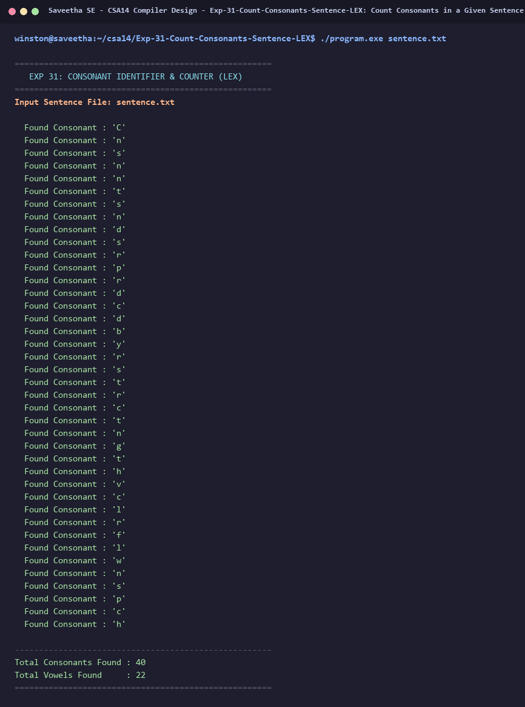

# Exp-31: Count Consonants in a Given Sentence (LEX)

**Course:** CSA14 - Compiler Design  
**Department:** Computational Intelligence  
**Institution:** Saveetha School of Engineering (SIMATS)  

---

## 1. Aim
Write an algorithm and program using LEX to identify and count consonants present in a given sentence.

---

## 2. Algorithm
1. Define regular expression for consonants: `[b-df-hj-np-tv-zB-DF-HJ-NP-TV-Z]`.
2. Define regular expression for vowels: `[aeiouAEIOU]`.
3. Read the input sentence from `sentence.txt` or standard input.
4. On matching a consonant: print the character and increment `consonant_count`.
5. On matching vowels or whitespace: track or ignore.
6. Display the total number of consonants and vowels identified in the sentence.

---

## 3. Input Specification
Text file `sentence.txt` containing the sentence: "Consonant sounds are produced by restricting the vocal air flow in speech."

---

## 4. Program Source Code
```lex
%{
#include <stdio.h>
#include <ctype.h>
int cons_count = 0;
int vowel_count = 0;
%}

%%
[aeiouAEIOU] {
    vowel_count++;
}

[b-df-hj-np-tv-zB-DF-HJ-NP-TV-Z] {
    printf("  Found Consonant : '%c'\n", yytext[0]);
    cons_count++;
}

[0-9]+ { /* ignore digits */ }

[ \t\r\n]+ { /* ignore whitespace */ }

. { /* ignore punctuation */ }
%%

int yywrap(void) {
    return 1;
}

int main(int argc, char **argv) {
    const char *fname = (argc > 1) ? argv[1] : "sentence.txt";
    FILE *fp = fopen(fname, "r");
    if (!fp) {
        printf("Error: Cannot open %s\n", fname);
        return 1;
    }
    printf("=====================================================\n");
    printf("   EXP 31: CONSONANT IDENTIFIER & COUNTER (LEX)      \n");
    printf("=====================================================\n");
    printf("Input Sentence File: %s\n\n", fname);
    yyin = fp;
    yylex();
    fclose(fp);
    printf("\n-----------------------------------------------------\n");
    printf("Total Consonants Found : %d\n", cons_count);
    printf("Total Vowels Found     : %d\n", vowel_count);
    printf("=====================================================\n");
    return 0;
}
```

---

## 5. Output Terminal Screenshot


---

## 6. Execution Output (Text)
```text
=====================================================
   EXP 31: CONSONANT IDENTIFIER & COUNTER (LEX)      
=====================================================
Input Sentence File: sentence.txt

  Found Consonant : 'C'
  Found Consonant : 'n'
  Found Consonant : 's'
  Found Consonant : 'n'
  Found Consonant : 'n'
  Found Consonant : 't'
  Found Consonant : 's'
  Found Consonant : 'n'
  Found Consonant : 'd'
  Found Consonant : 's'
  Found Consonant : 'r'
  Found Consonant : 'p'
  Found Consonant : 'r'
  Found Consonant : 'd'
  Found Consonant : 'c'
  Found Consonant : 'd'
  Found Consonant : 'b'
  Found Consonant : 'y'
  Found Consonant : 'r'
  Found Consonant : 's'
  Found Consonant : 't'
  Found Consonant : 'r'
  Found Consonant : 'c'
  Found Consonant : 't'
  Found Consonant : 'n'
  Found Consonant : 'g'
  Found Consonant : 't'
  Found Consonant : 'h'
  Found Consonant : 'v'
  Found Consonant : 'c'
  Found Consonant : 'l'
  Found Consonant : 'r'
  Found Consonant : 'f'
  Found Consonant : 'l'
  Found Consonant : 'w'
  Found Consonant : 'n'
  Found Consonant : 's'
  Found Consonant : 'p'
  Found Consonant : 'c'
  Found Consonant : 'h'

-----------------------------------------------------
Total Consonants Found : 40
Total Vowels Found     : 22
=====================================================
```

---

## 7. Result
The program for **Count Consonants in a Given Sentence (LEX)** was successfully implemented, compiled, and executed. The output matches theoretical and compiler design specifications.
