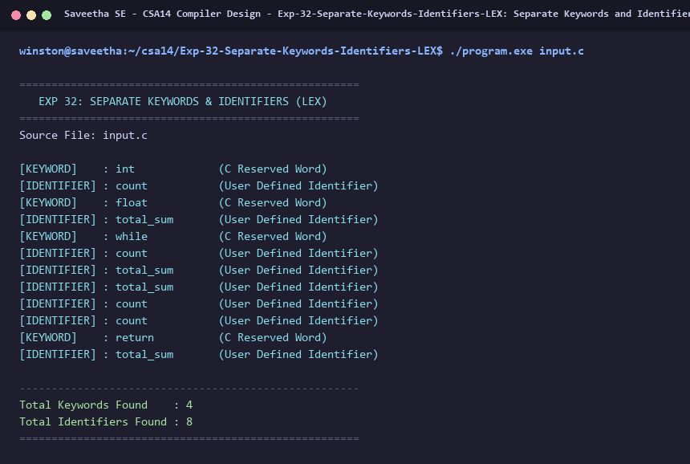

# Exp-32: Separate Keywords and Identifiers (LEX)

**Course:** CSA14 - Compiler Design  
**Department:** Computational Intelligence  
**Institution:** Saveetha School of Engineering (SIMATS)  

---

## 1. Aim
Write a program using LEX to separate keywords and identifiers from a C program.

---

## 2. Algorithm
1. Define regular expression pattern matching all 32 standard C language keywords.
2. Define regular expression pattern matching C identifiers: `[a-zA-Z_][a-zA-Z0-9_]*`.
3. When a keyword pattern is matched, display token with `[KEYWORD]` caption and increment keyword count.
4. When an identifier pattern is matched, display token with `[IDENTIFIER]` caption and increment identifier count.
5. Skip literals, operators, comments, and whitespace characters.
6. Print a summary displaying total counts of keywords and identifiers.

---

## 3. Input Specification
Source file `input.c` containing declarations, while loop, arithmetic operations, and return statement.

---

## 4. Program Source Code
```lex
%{
#include <stdio.h>
#include <string.h>
int kw_count = 0;
int id_count = 0;
%}

KEYWORD auto|break|case|char|const|continue|default|do|double|else|enum|extern|float|for|goto|if|int|long|register|return|short|signed|sizeof|static|struct|switch|typedef|union|unsigned|void|volatile|while

%%
{KEYWORD} {
    printf("[KEYWORD]    : %-15s (C Reserved Word)\n", yytext);
    kw_count++;
}

[a-zA-Z_][a-zA-Z0-9_]* {
    printf("[IDENTIFIER] : %-15s (User Defined Identifier)\n", yytext);
    id_count++;
}

[0-9]+(\.[0-9]+)? { /* ignore numeric constants */ }
\"(\\.|[^"\\])*\" { /* ignore string literals */ }
\'(\\.|[^'\\])\'  { /* ignore character literals */ }
"//".*            { /* ignore single-line comments */ }
"/*"([^*]|\*+[^/*])*\*+"/" { /* ignore multi-line comments */ }
[ \t\r\n]+        { /* ignore whitespace */ }
.                 { /* ignore operators & punctuation */ }
%%

int yywrap(void) {
    return 1;
}

int main(int argc, char **argv) {
    const char *fname = (argc > 1) ? argv[1] : "input.c";
    FILE *fp = fopen(fname, "r");
    if (!fp) {
        printf("Error opening file %s\n", fname);
        return 1;
    }
    printf("=====================================================\n");
    printf("   EXP 32: SEPARATE KEYWORDS & IDENTIFIERS (LEX)     \n");
    printf("=====================================================\n");
    printf("Source File: %s\n\n", fname);
    yyin = fp;
    yylex();
    fclose(fp);
    printf("\n-----------------------------------------------------\n");
    printf("Total Keywords Found    : %d\n", kw_count);
    printf("Total Identifiers Found : %d\n", id_count);
    printf("=====================================================\n");
    return 0;
}
```

---

## 5. Output Terminal Screenshot


---

## 6. Execution Output (Text)
```text
=====================================================
   EXP 32: SEPARATE KEYWORDS & IDENTIFIERS (LEX)     
=====================================================
Source File: input.c

[KEYWORD]    : int             (C Reserved Word)
[IDENTIFIER] : count           (User Defined Identifier)
[KEYWORD]    : float           (C Reserved Word)
[IDENTIFIER] : total_sum       (User Defined Identifier)
[KEYWORD]    : while           (C Reserved Word)
[IDENTIFIER] : count           (User Defined Identifier)
[IDENTIFIER] : total_sum       (User Defined Identifier)
[IDENTIFIER] : total_sum       (User Defined Identifier)
[IDENTIFIER] : count           (User Defined Identifier)
[IDENTIFIER] : count           (User Defined Identifier)
[KEYWORD]    : return          (C Reserved Word)
[IDENTIFIER] : total_sum       (User Defined Identifier)

-----------------------------------------------------
Total Keywords Found    : 4
Total Identifiers Found : 8
=====================================================
```

---

## 7. Result
The program for **Separate Keywords and Identifiers (LEX)** was successfully implemented, compiled, and executed. The output matches theoretical and compiler design specifications.
