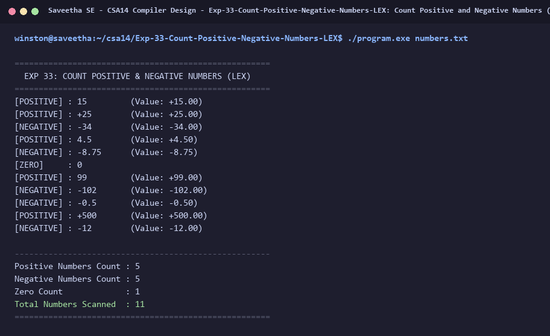

# Exp-33: Count Positive and Negative Numbers (LEX)

**Course:** CSA14 - Compiler Design  
**Department:** Computational Intelligence  
**Institution:** Saveetha School of Engineering (SIMATS)  

---

## 1. Aim
Write a program using LEX to identify and count the number of positive and negative numbers.

---

## 2. Algorithm
1. Define regular expression patterns for negative numbers: `-[0-9]+(\.[0-9]+)?`.
2. Define regular expression patterns for positive numbers: `\+?[0-9]+(\.[0-9]+)?`.
3. Check for numerical zero and categorize separately if desired.
4. Increment positive counter for positive values and negative counter for negative values.
5. Ignore spaces, commas, and formatting delimiters.
6. Display individual recognized numbers and final summary tallies.

---

## 3. Input Specification
Data file `numbers.txt` containing integer and floating-point positive and negative numbers.

---

## 4. Program Source Code
```lex
%{
#include <stdio.h>
#include <stdlib.h>
int pos_count = 0;
int neg_count = 0;
int zero_count = 0;
%}

%%
\+?[0-9]+(\.[0-9]+)? {
    double val = atof(yytext);
    if (val == 0.0) {
        printf("[ZERO]     : %-10s\n", yytext);
        zero_count++;
    } else {
        printf("[POSITIVE] : %-10s (Value: +%.2f)\n", yytext, val);
        pos_count++;
    }
}

-[0-9]+(\.[0-9]+)? {
    double val = atof(yytext);
    printf("[NEGATIVE] : %-10s (Value: %.2f)\n", yytext, val);
    neg_count++;
}

[ \t\r\n,]+ { /* ignore whitespace and commas */ }
.           { /* ignore other characters */ }
%%

int yywrap(void) {
    return 1;
}

int main(int argc, char **argv) {
    printf("=====================================================\n");
    printf("  EXP 33: COUNT POSITIVE & NEGATIVE NUMBERS (LEX)    \n");
    printf("=====================================================\n");
    if (argc > 1) {
        FILE *fp = fopen(argv[1], "r");
        if (!fp) {
            printf("Error opening file %s\n", argv[1]);
            return 1;
        }
        yyin = fp;
    }
    yylex();
    printf("\n-----------------------------------------------------\n");
    printf("Positive Numbers Count : %d\n", pos_count);
    printf("Negative Numbers Count : %d\n", neg_count);
    printf("Zero Count             : %d\n", zero_count);
    printf("Total Numbers Scanned  : %d\n", pos_count + neg_count + zero_count);
    printf("=====================================================\n");
    return 0;
}
```

---

## 5. Output Terminal Screenshot


---

## 6. Execution Output (Text)
```text
=====================================================
  EXP 33: COUNT POSITIVE & NEGATIVE NUMBERS (LEX)    
=====================================================
[POSITIVE] : 15         (Value: +15.00)
[POSITIVE] : +25        (Value: +25.00)
[NEGATIVE] : -34        (Value: -34.00)
[POSITIVE] : 4.5        (Value: +4.50)
[NEGATIVE] : -8.75      (Value: -8.75)
[ZERO]     : 0         
[POSITIVE] : 99         (Value: +99.00)
[NEGATIVE] : -102       (Value: -102.00)
[NEGATIVE] : -0.5       (Value: -0.50)
[POSITIVE] : +500       (Value: +500.00)
[NEGATIVE] : -12        (Value: -12.00)

-----------------------------------------------------
Positive Numbers Count : 5
Negative Numbers Count : 5
Zero Count             : 1
Total Numbers Scanned  : 11
=====================================================
```

---

## 7. Result
The program for **Count Positive and Negative Numbers (LEX)** was successfully implemented, compiled, and executed. The output matches theoretical and compiler design specifications.
