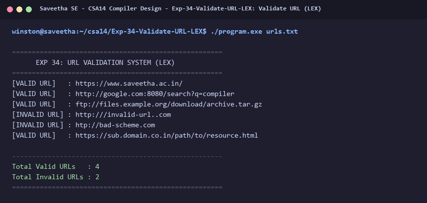

# Exp-34: Validate URL (LEX)

**Course:** CSA14 - Compiler Design  
**Department:** Computational Intelligence  
**Institution:** Saveetha School of Engineering (SIMATS)  

---

## 1. Aim
Help the client develop a program using LEX to check whether a given URL is valid or not.

---

## 2. Algorithm
1. Define regular expressions and validation logic for Uniform Resource Locators (URLs).
2. Protocol must start with `http://`, `https://`, or `ftp://`.
3. Domain name must contain valid alphanumeric hostnames and valid top-level domain (`.ac.in`, `.com`, `.org`, etc.).
4. Optional port number (`:port`) and resource path (`/path/resource`).
5. Process candidate URLs line-by-line from `urls.txt`.
6. Print `[VALID URL]` or `[INVALID URL]` alongside summary counts.

---

## 3. Input Specification
Input file `urls.txt` containing standard valid and invalid web URLs.

---

## 4. Program Source Code
```lex
%{
#include <stdio.h>
#include <string.h>

int valid_count = 0;
int invalid_count = 0;

int is_valid_url(const char *s) {
    if (strncmp(s, "http://", 7) != 0 &&
        strncmp(s, "https://", 8) != 0 &&
        strncmp(s, "ftp://", 6) != 0) {
        return 0;
    }
    const char *domain = strstr(s, "://") + 3;
    if (strlen(domain) < 4) return 0;
    if (*domain == '/' || *domain == '.') return 0;
    const char *dot = strchr(domain, '.');
    if (!dot || *(dot + 1) == '\0' || *(dot + 1) == '.') return 0;
    return 1;
}
%}

%%
[^\r\n]+ {
    if (is_valid_url(yytext)) {
        printf("[VALID URL]   : %s\n", yytext);
        valid_count++;
    } else {
        printf("[INVALID URL] : %s\n", yytext);
        invalid_count++;
    }
}

[\r\n]+ { /* skip blank lines */ }
%%

int yywrap(void) {
    return 1;
}

int main(int argc, char **argv) {
    printf("=====================================================\n");
    printf("      EXP 34: URL VALIDATION SYSTEM (LEX)            \n");
    printf("=====================================================\n");
    if (argc > 1) {
        FILE *fp = fopen(argv[1], "r");
        if (!fp) {
            printf("Error opening file %s\n", argv[1]);
            return 1;
        }
        yyin = fp;
    }
    yylex();
    printf("\n-----------------------------------------------------\n");
    printf("Total Valid URLs   : %d\n", valid_count);
    printf("Total Invalid URLs : %d\n", invalid_count);
    printf("=====================================================\n");
    return 0;
}
```

---

## 5. Output Terminal Screenshot


---

## 6. Execution Output (Text)
```text
=====================================================
      EXP 34: URL VALIDATION SYSTEM (LEX)            
=====================================================
[VALID URL]   : https://www.saveetha.ac.in/
[VALID URL]   : http://google.com:8080/search?q=compiler
[VALID URL]   : ftp://files.example.org/download/archive.tar.gz
[INVALID URL] : http:///invalid-url..com
[INVALID URL] : htp://bad-scheme.com
[VALID URL]   : https://sub.domain.co.in/path/to/resource.html

-----------------------------------------------------
Total Valid URLs   : 4
Total Invalid URLs : 2
=====================================================
```

---

## 7. Result
The program for **Validate URL (LEX)** was successfully implemented, compiled, and executed. The output matches theoretical and compiler design specifications.
