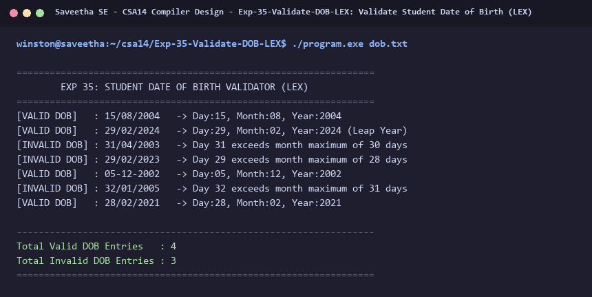

# Exp-35: Validate Student Date of Birth (LEX)

**Course:** CSA14 - Compiler Design  
**Department:** Computational Intelligence  
**Institution:** Saveetha School of Engineering (SIMATS)  

---

## 1. Aim
Write a program using LEX to check whether a student's Date of Birth (DOB) is valid or not for sports day participation.

---

## 2. Algorithm
1. Match date entries in `DD/MM/YYYY` or `DD-MM-YYYY` format using regular expressions.
2. Extract Day, Month, and Year components.
3. Validate:
   - Year range (e.g. 1900 to 2026).
   - Month range (1 to 12).
   - Maximum days per month (31 days for Jan, Mar, May, Jul, Aug, Oct, Dec; 30 days for Apr, Jun, Sep, Nov).
   - Leap year rules for February (29 days if leap year, 28 days otherwise).
4. Label each input date as `[VALID DOB]` or `[INVALID DOB]` with descriptive feedback.
5. Print total counts of valid and invalid date entries.

---

## 3. Input Specification
Input file `dob.txt` containing test dates including valid dates, invalid months/days, and leap year tests.

---

## 4. Program Source Code
```lex
%{
#include <stdio.h>
#include <stdlib.h>
#include <string.h>

int valid_dob = 0;
int invalid_dob = 0;

int is_leap(int year) {
    return ((year % 4 == 0 && year % 100 != 0) || (year % 400 == 0));
}

void validate_date(int d, int m, int y, const char *orig) {
    int max_d = 31;
    if (y < 1900 || y > 2026) {
        printf("[INVALID DOB] : %-12s -> Year %d out of valid range (1900-2026)\n", orig, y);
        invalid_dob++;
        return;
    }
    if (m < 1 || m > 12) {
        printf("[INVALID DOB] : %-12s -> Month %d is invalid (must be 1-12)\n", orig, m);
        invalid_dob++;
        return;
    }
    if (m == 4 || m == 6 || m == 9 || m == 11) {
        max_d = 30;
    } else if (m == 2) {
        max_d = is_leap(y) ? 29 : 28;
    }
    if (d < 1 || d > max_d) {
        printf("[INVALID DOB] : %-12s -> Day %d exceeds month maximum of %d days\n", orig, d, max_d);
        invalid_dob++;
        return;
    }
    printf("[VALID DOB]   : %-12s -> Day:%02d, Month:%02d, Year:%d%s\n",
           orig, d, m, y, (m == 2 && is_leap(y)) ? " (Leap Year)" : "");
    valid_dob++;
}
%}

%%
[0-9]{1,2}[/-][0-9]{1,2}[/-][0-9]{4} {
    int d, m, y;
    if (strchr(yytext, '/')) {
        sscanf(yytext, "%d/%d/%d", &d, &m, &y);
    } else {
        sscanf(yytext, "%d-%d-%d", &d, &m, &y);
    }
    validate_date(d, m, y, yytext);
}

[^\r\n]+ {
    printf("[INVALID DOB] : %-12s -> Malformed date format (expected DD/MM/YYYY)\n", yytext);
    invalid_dob++;
}

[\r\n]+ { /* skip */ }
%%

int yywrap(void) {
    return 1;
}

int main(int argc, char **argv) {
    printf("=================================================================\n");
    printf("        EXP 35: STUDENT DATE OF BIRTH VALIDATOR (LEX)            \n");
    printf("=================================================================\n");
    if (argc > 1) {
        FILE *fp = fopen(argv[1], "r");
        if (!fp) {
            printf("Error opening file %s\n", argv[1]);
            return 1;
        }
        yyin = fp;
    }
    yylex();
    printf("\n-----------------------------------------------------------------\n");
    printf("Total Valid DOB Entries   : %d\n", valid_dob);
    printf("Total Invalid DOB Entries : %d\n", invalid_dob);
    printf("=================================================================\n");
    return 0;
}
```

---

## 5. Output Terminal Screenshot


---

## 6. Execution Output (Text)
```text
=================================================================
        EXP 35: STUDENT DATE OF BIRTH VALIDATOR (LEX)            
=================================================================
[VALID DOB]   : 15/08/2004   -> Day:15, Month:08, Year:2004
[VALID DOB]   : 29/02/2024   -> Day:29, Month:02, Year:2024 (Leap Year)
[INVALID DOB] : 31/04/2003   -> Day 31 exceeds month maximum of 30 days
[INVALID DOB] : 29/02/2023   -> Day 29 exceeds month maximum of 28 days
[VALID DOB]   : 05-12-2002   -> Day:05, Month:12, Year:2002
[INVALID DOB] : 32/01/2005   -> Day 32 exceeds month maximum of 31 days
[VALID DOB]   : 28/02/2021   -> Day:28, Month:02, Year:2021

-----------------------------------------------------------------
Total Valid DOB Entries   : 4
Total Invalid DOB Entries : 3
=================================================================
```

---

## 7. Result
The program for **Validate Student Date of Birth (LEX)** was successfully implemented, compiled, and executed. The output matches theoretical and compiler design specifications.
