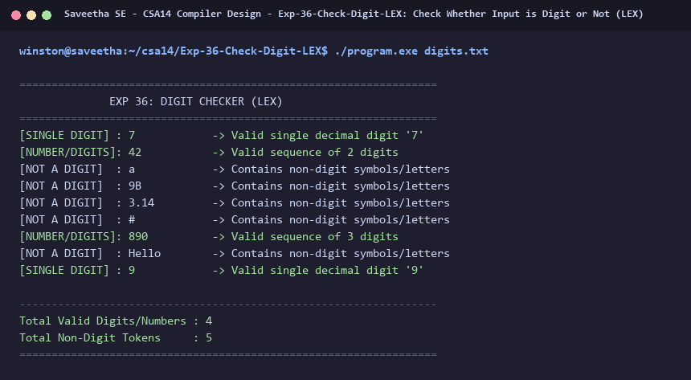

# Exp-36: Check Whether Input is Digit or Not (LEX)

**Course:** CSA14 - Compiler Design  
**Department:** Computational Intelligence  
**Institution:** Saveetha School of Engineering (SIMATS)  

---

## 1. Aim
Write a program using LEX to check whether a given input token is a digit or not.

---

## 2. Algorithm
1. Define regular expression patterns for single digits `[0-9]` and multi-digit numbers `[0-9]+`.
2. Define pattern for non-digit tokens (alphabets, symbols, floating point numbers).
3. Scan tokens from input data file `digits.txt`.
4. If a token consists strictly of a single decimal digit, classify as `[SINGLE DIGIT]`.
5. If a token consists of multiple decimal digits, classify as `[NUMBER/DIGITS]`.
6. Otherwise, classify as `[NOT A DIGIT]`.
7. Display total counts of digits and non-digits.

---

## 3. Input Specification
Data file `digits.txt` containing digits, numbers, letters, and punctuation marks.

---

## 4. Program Source Code
```lex
%{
#include <stdio.h>
#include <ctype.h>
#include <string.h>

int digit_count = 0;
int non_digit_count = 0;
%}

%%
[^\r\n]+ {
    int is_all_digits = 1;
    for (int i = 0; yytext[i] != '\0'; i++) {
        if (!isdigit((unsigned char)yytext[i])) {
            is_all_digits = 0;
            break;
        }
    }
    if (is_all_digits && strlen(yytext) == 1) {
        printf("[SINGLE DIGIT] : %-12s -> Valid single decimal digit '%s'\n", yytext, yytext);
        digit_count++;
    } else if (is_all_digits) {
        printf("[NUMBER/DIGITS]: %-12s -> Valid sequence of %d digits\n", yytext, (int)strlen(yytext));
        digit_count++;
    } else {
        printf("[NOT A DIGIT]  : %-12s -> Contains non-digit symbols/letters\n", yytext);
        non_digit_count++;
    }
}

[\r\n]+ { /* skip */ }
%%

int yywrap(void) {
    return 1;
}

int main(int argc, char **argv) {
    printf("=================================================================\n");
    printf("              EXP 36: DIGIT CHECKER (LEX)                        \n");
    printf("=================================================================\n");
    if (argc > 1) {
        FILE *fp = fopen(argv[1], "r");
        if (!fp) {
            printf("Error opening file %s\n", argv[1]);
            return 1;
        }
        yyin = fp;
    }
    yylex();
    printf("\n-----------------------------------------------------------------\n");
    printf("Total Valid Digits/Numbers : %d\n", digit_count);
    printf("Total Non-Digit Tokens     : %d\n", non_digit_count);
    printf("=================================================================\n");
    return 0;
}
```

---

## 5. Output Terminal Screenshot


---

## 6. Execution Output (Text)
```text
=================================================================
              EXP 36: DIGIT CHECKER (LEX)                        
=================================================================
[SINGLE DIGIT] : 7            -> Valid single decimal digit '7'
[NUMBER/DIGITS]: 42           -> Valid sequence of 2 digits
[NOT A DIGIT]  : a            -> Contains non-digit symbols/letters
[NOT A DIGIT]  : 9B           -> Contains non-digit symbols/letters
[NOT A DIGIT]  : 3.14         -> Contains non-digit symbols/letters
[NOT A DIGIT]  : #            -> Contains non-digit symbols/letters
[NUMBER/DIGITS]: 890          -> Valid sequence of 3 digits
[NOT A DIGIT]  : Hello        -> Contains non-digit symbols/letters
[SINGLE DIGIT] : 9            -> Valid single decimal digit '9'

-----------------------------------------------------------------
Total Valid Digits/Numbers : 4
Total Non-Digit Tokens     : 5
=================================================================
```

---

## 7. Result
The program for **Check Whether Input is Digit or Not (LEX)** was successfully implemented, compiled, and executed. The output matches theoretical and compiler design specifications.
