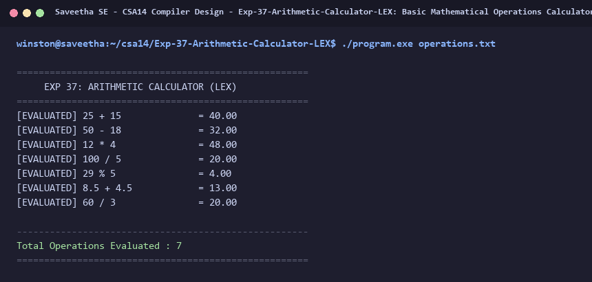

# Exp-37: Basic Mathematical Operations Calculator (LEX)

**Course:** CSA14 - Compiler Design  
**Department:** Computational Intelligence  
**Institution:** Saveetha School of Engineering (SIMATS)  

---

## 1. Aim
Write a program using LEX to evaluate and verify basic mathematical operations (+, -, *, /, %).

---

## 2. Algorithm
1. Define regular expression patterns for operands (integer and floating-point numbers) and operators (`+`, `-`, `*`, `/`, `%`).
2. Read arithmetic expressions from `operations.txt`.
3. Parse the left operand, operator character, and right operand.
4. Compute the mathematical result based on the operator:
   - Addition: `op1 + op2`
   - Subtraction: `op1 - op2`
   - Multiplication: `op1 * op2`
   - Division: `op1 / op2` (with zero division check)
   - Modulo: `(int)op1 % (int)op2`
5. Print each evaluation equation and summarize total operations calculated.

---

## 3. Input Specification
File `operations.txt` containing arithmetic expressions representing basic operations.

---

## 4. Program Source Code
```lex
%{
#include <stdio.h>
#include <stdlib.h>
int op_count = 0;
%}

%%
[0-9]+(\.[0-9]+)?[ \t]*[\+\-\*\/\%][ \t]*[0-9]+(\.[0-9]+)? {
    double op1 = 0, op2 = 0, res = 0;
    char op = 0;
    char *p = yytext;
    op1 = strtod(p, &p);
    while (*p == ' ' || *p == '\t') p++;
    op = *p++;
    op2 = strtod(p, NULL);

    int err = 0;
    switch(op) {
        case '+': res = op1 + op2; break;
        case '-': res = op1 - op2; break;
        case '*': res = op1 * op2; break;
        case '/':
            if (op2 == 0) {
                printf("[DIV BY ZERO] : %s\n", yytext);
                err = 1;
            } else {
                res = op1 / op2;
            }
            break;
        case '%':
            if ((int)op2 == 0) {
                printf("[MOD BY ZERO] : %s\n", yytext);
                err = 1;
            } else {
                res = (int)op1 % (int)op2;
            }
            break;
        default: err = 1; break;
    }
    if (!err) {
        printf("[EVALUATED] %-20s = %.2f\n", yytext, res);
        op_count++;
    }
}

[^\r\n]+ {
    printf("[INVALID EXPR] : %s\n", yytext);
}

[\r\n]+ { /* skip */ }
%%

int yywrap(void) {
    return 1;
}

int main(int argc, char **argv) {
    printf("=====================================================\n");
    printf("     EXP 37: ARITHMETIC CALCULATOR (LEX)             \n");
    printf("=====================================================\n");
    if (argc > 1) {
        FILE *fp = fopen(argv[1], "r");
        if (!fp) {
            printf("Error opening file %s\n", argv[1]);
            return 1;
        }
        yyin = fp;
    }
    yylex();
    printf("\n-----------------------------------------------------\n");
    printf("Total Operations Evaluated : %d\n", op_count);
    printf("=====================================================\n");
    return 0;
}
```

---

## 5. Output Terminal Screenshot


---

## 6. Execution Output (Text)
```text
=====================================================
     EXP 37: ARITHMETIC CALCULATOR (LEX)             
=====================================================
[EVALUATED] 25 + 15              = 40.00
[EVALUATED] 50 - 18              = 32.00
[EVALUATED] 12 * 4               = 48.00
[EVALUATED] 100 / 5              = 20.00
[EVALUATED] 29 % 5               = 4.00
[EVALUATED] 8.5 + 4.5            = 13.00
[EVALUATED] 60 / 3               = 20.00

-----------------------------------------------------
Total Operations Evaluated : 7
=====================================================
```

---

## 7. Result
The program for **Basic Mathematical Operations Calculator (LEX)** was successfully implemented, compiled, and executed. The output matches theoretical and compiler design specifications.
