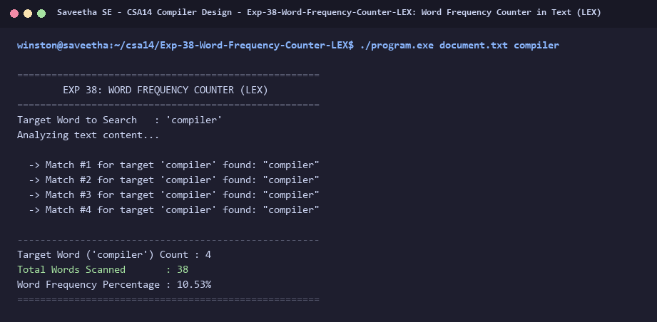

# Exp-38: Word Frequency Counter in Text (LEX)

**Course:** CSA14 - Compiler Design  
**Department:** Computational Intelligence  
**Institution:** Saveetha School of Engineering (SIMATS)  

---

## 1. Aim
Write a program using LEX to find the frequency of a target word in a given sentence or text.

---

## 2. Algorithm
1. Receive target search word via command-line arguments or defaults (`compiler`).
2. Define pattern `[a-zA-Z0-9_]+` to extract individual words.
3. Compare each extracted word case-insensitively with the target word.
4. When a match occurs, increment `target_freq` and print match occurrence.
5. Increment `total_words` for every recognized word token.
6. Display total target occurrences, total word count, and word density percentage.

---

## 3. Input Specification
Text document `document.txt` and target word `compiler` passed as command-line arguments.

---

## 4. Program Source Code
```lex
%{
#include <stdio.h>
#include <string.h>
#include <ctype.h>

char target_word[128] = "compiler";
int target_freq = 0;
int total_words = 0;

int str_case_cmp(const char *s1, const char *s2) {
    while (*s1 && *s2) {
        if (tolower((unsigned char)*s1) != tolower((unsigned char)*s2))
            return 1;
        s1++;
        s2++;
    }
    return tolower((unsigned char)*s1) != tolower((unsigned char)*s2);
}
%}

%%
[a-zA-Z0-9_]+ {
    total_words++;
    if (str_case_cmp(yytext, target_word) == 0) {
        target_freq++;
        printf("  -> Match #%d for target '%s' found: \"%s\"\n", target_freq, target_word, yytext);
    }
}

[ \t\r\n]+ { /* ignore */ }
.          { /* ignore punctuation */ }
%%

int yywrap(void) {
    return 1;
}

int main(int argc, char **argv) {
    printf("=====================================================\n");
    printf("        EXP 38: WORD FREQUENCY COUNTER (LEX)         \n");
    printf("=====================================================\n");
    if (argc > 1) {
        FILE *fp = fopen(argv[1], "r");
        if (!fp) {
            printf("Error opening file %s\n", argv[1]);
            return 1;
        }
        yyin = fp;
    }
    if (argc > 2) {
        strncpy(target_word, argv[2], sizeof(target_word) - 1);
        target_word[sizeof(target_word) - 1] = '\0';
    }
    printf("Target Word to Search   : '%s'\n", target_word);
    printf("Analyzing text content...\n\n");
    yylex();
    printf("\n-----------------------------------------------------\n");
    printf("Target Word ('%s') Count : %d\n", target_word, target_freq);
    printf("Total Words Scanned       : %d\n", total_words);
    if (total_words > 0) {
        printf("Word Frequency Percentage : %.2f%%\n", ((double)target_freq / total_words) * 100.0);
    }
    printf("=====================================================\n");
    return 0;
}
```

---

## 5. Output Terminal Screenshot


---

## 6. Execution Output (Text)
```text
=====================================================
        EXP 38: WORD FREQUENCY COUNTER (LEX)         
=====================================================
Target Word to Search   : 'compiler'
Analyzing text content...

  -> Match #1 for target 'compiler' found: "compiler"
  -> Match #2 for target 'compiler' found: "compiler"
  -> Match #3 for target 'compiler' found: "compiler"
  -> Match #4 for target 'compiler' found: "compiler"

-----------------------------------------------------
Target Word ('compiler') Count : 4
Total Words Scanned       : 38
Word Frequency Percentage : 10.53%
=====================================================
```

---

## 7. Result
The program for **Word Frequency Counter in Text (LEX)** was successfully implemented, compiled, and executed. The output matches theoretical and compiler design specifications.
