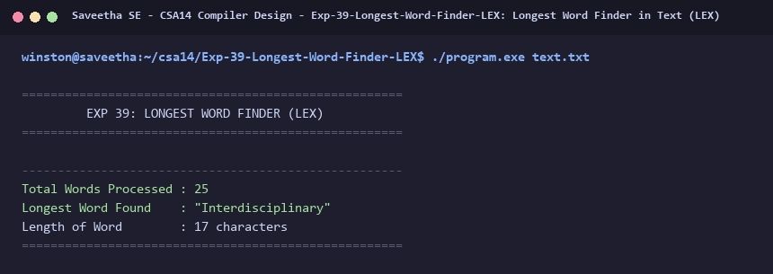

# Exp-39: Longest Word Finder in Text (LEX)

**Course:** CSA14 - Compiler Design  
**Department:** Computational Intelligence  
**Institution:** Saveetha School of Engineering (SIMATS)  

---

## 1. Aim
Write a program using LEX to scan input text and determine the longest word and its length.

---

## 2. Algorithm
1. Initialize `max_len = 0` and buffer `longest_word[256] = ""`.
2. Define regular expression `[a-zA-Z]+` to match words.
3. For each word token, compare token length `yyleng` with `max_len`.
4. If `yyleng > max_len`, update `max_len = yyleng` and store `yytext` in `longest_word`.
5. Ignore whitespace, numbers, and punctuation marks.
6. Print the longest word, total words processed, and its character count.

---

## 3. Input Specification
Text document `text.txt` containing university engineering and technical sentences.

---

## 4. Program Source Code
```lex
%{
#include <stdio.h>
#include <string.h>

char longest_word[256] = "";
int max_len = 0;
int word_count = 0;
%}

%%
[a-zA-Z]+ {
    word_count++;
    if (yyleng > max_len) {
        max_len = yyleng;
        strncpy(longest_word, yytext, sizeof(longest_word) - 1);
        longest_word[sizeof(longest_word) - 1] = '\0';
    }
}

[ \t\r\n]+ { /* ignore whitespace */ }
.          { /* ignore digits & punctuation */ }
%%

int yywrap(void) {
    return 1;
}

int main(int argc, char **argv) {
    printf("=====================================================\n");
    printf("         EXP 39: LONGEST WORD FINDER (LEX)           \n");
    printf("=====================================================\n");
    if (argc > 1) {
        FILE *fp = fopen(argv[1], "r");
        if (!fp) {
            printf("Error opening file %s\n", argv[1]);
            return 1;
        }
        yyin = fp;
    }
    yylex();
    printf("\n-----------------------------------------------------\n");
    printf("Total Words Processed : %d\n", word_count);
    printf("Longest Word Found    : \"%s\"\n", longest_word);
    printf("Length of Word        : %d characters\n", max_len);
    printf("=====================================================\n");
    return 0;
}
```

---

## 5. Output Terminal Screenshot


---

## 6. Execution Output (Text)
```text
=====================================================
         EXP 39: LONGEST WORD FINDER (LEX)           
=====================================================

-----------------------------------------------------
Total Words Processed : 25
Longest Word Found    : "Interdisciplinary"
Length of Word        : 17 characters
=====================================================
```

---

## 7. Result
The program for **Longest Word Finder in Text (LEX)** was successfully implemented, compiled, and executed. The output matches theoretical and compiler design specifications.
