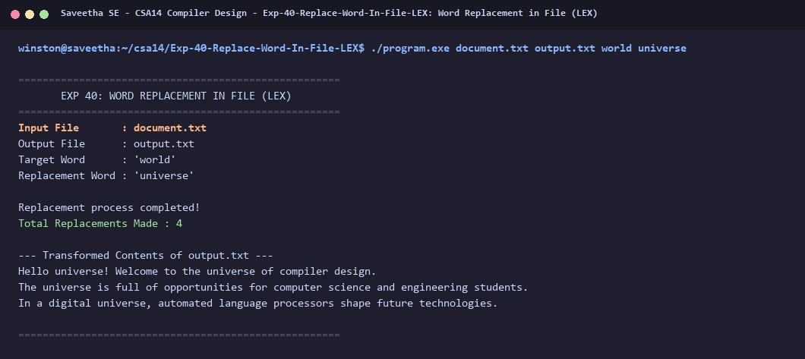

# Exp-40: Word Replacement in File (LEX)

**Course:** CSA14 - Compiler Design  
**Department:** Computational Intelligence  
**Institution:** Saveetha School of Engineering (SIMATS)  

---

## 1. Aim
Write a program using LEX to replace all occurrences of a specified word with another word in a document file.

---

## 2. Algorithm
1. Take input filename, output filename, search word, and replacement word from command line.
2. Direct `yyin` to input file and `yyout` to output file.
3. Match words `[a-zA-Z0-9_]+`:
   - If word equals search word, write replacement word to `yyout` and increment replacement count.
   - Otherwise, write matched word as-is to `yyout`.
4. Echo all other whitespace, punctuation, and newline characters unchanged to `yyout`.
5. Display replacement summary and print the transformed file contents.

---

## 3. Input Specification
Input file `document.txt`, replacing target word `world` with `universe` into `output.txt`.

---

## 4. Program Source Code
```lex
%{
#include <stdio.h>
#include <string.h>

char find_word[128] = "world";
char replace_word[128] = "universe";
int replacements = 0;
%}

%%
[a-zA-Z0-9_]+ {
    if (strcmp(yytext, find_word) == 0) {
        fprintf(yyout, "%s", replace_word);
        replacements++;
    } else {
        fprintf(yyout, "%s", yytext);
    }
}

.|\n {
    fprintf(yyout, "%s", yytext);
}
%%

int yywrap(void) {
    return 1;
}

int main(int argc, char **argv) {
    printf("=====================================================\n");
    printf("       EXP 40: WORD REPLACEMENT IN FILE (LEX)        \n");
    printf("=====================================================\n");
    char in_file[256] = "document.txt";
    char out_file[256] = "output.txt";
    if (argc > 1) strncpy(in_file, argv[1], sizeof(in_file) - 1);
    if (argc > 2) strncpy(out_file, argv[2], sizeof(out_file) - 1);
    if (argc > 3) strncpy(find_word, argv[3], sizeof(find_word) - 1);
    if (argc > 4) strncpy(replace_word, argv[4], sizeof(replace_word) - 1);

    FILE *fin = fopen(in_file, "r");
    if (!fin) {
        printf("Error opening input file %s\n", in_file);
        return 1;
    }
    FILE *fout = fopen(out_file, "w");
    if (!fout) {
        printf("Error opening output file %s\n", out_file);
        fclose(fin);
        return 1;
    }
    yyin = fin;
    yyout = fout;

    printf("Input File       : %s\n", in_file);
    printf("Output File      : %s\n", out_file);
    printf("Target Word      : '%s'\n", find_word);
    printf("Replacement Word : '%s'\n\n", replace_word);

    yylex();

    fclose(fin);
    fclose(fout);

    printf("Replacement process completed!\n");
    printf("Total Replacements Made : %d\n", replacements);
    printf("\n--- Transformed Contents of %s ---\n", out_file);
    FILE *fres = fopen(out_file, "r");
    if (fres) {
        char ch;
        while ((ch = fgetc(fres)) != EOF) putchar(ch);
        fclose(fres);
    }
    printf("\n=====================================================\n");
    return 0;
}
```

---

## 5. Output Terminal Screenshot


---

## 6. Execution Output (Text)
```text
=====================================================
       EXP 40: WORD REPLACEMENT IN FILE (LEX)        
=====================================================
Input File       : document.txt
Output File      : output.txt
Target Word      : 'world'
Replacement Word : 'universe'

Replacement process completed!
Total Replacements Made : 4

--- Transformed Contents of output.txt ---
Hello universe! Welcome to the universe of compiler design.
The universe is full of opportunities for computer science and engineering students.
In a digital universe, automated language processors shape future technologies.

=====================================================
```

---

## 7. Result
The program for **Word Replacement in File (LEX)** was successfully implemented, compiled, and executed. The output matches theoretical and compiler design specifications.
