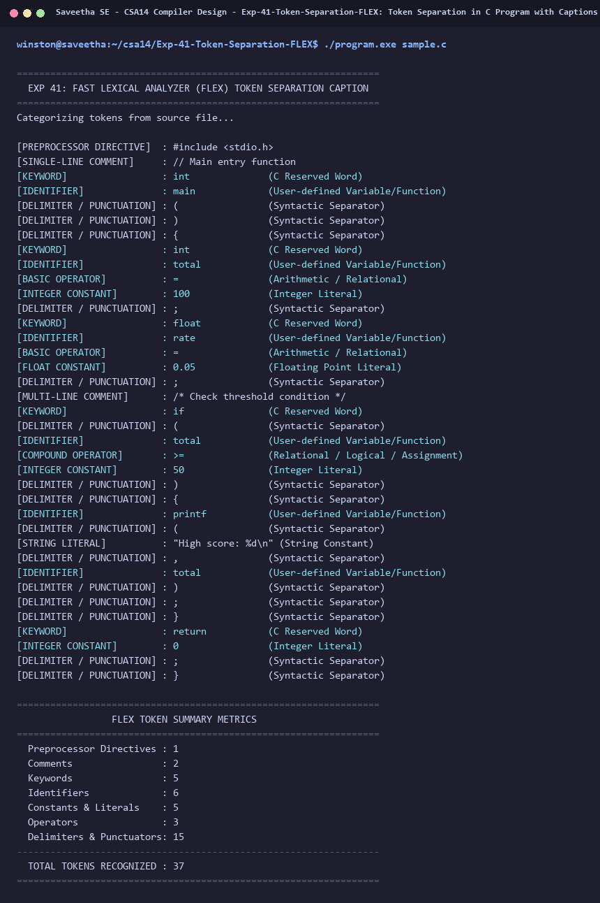

# Exp-41: Token Separation in C Program with Captions (FLEX)

**Course:** CSA14 - Compiler Design  
**Department:** Computational Intelligence  
**Institution:** Saveetha School of Engineering (SIMATS)  

---

## 1. Aim
Write a Fast Lexical Analyzer (FLEX) program to separate tokens in a C program with descriptive captions.

---

## 2. Algorithm
1. Define regular expressions for lexical categories:
   - Preprocessor Directives: `#.*`
   - Single-line and Multi-line Comments: `//.*`, `/* ... */`
   - C Keywords: 32 reserved words
   - Constants: Floating-point, integer, string, and character literals
   - Operators: Compound, arithmetic, relational, and logical
   - Identifiers: `[a-zA-Z_][a-zA-Z0-9_]*`
   - Delimiters/Punctuation: braces, brackets, commas, semicolons
2. Process C source file `sample.c`.
3. Print each token formatted with aligned classification captions.
4. Maintain category counters and display summary metrics.

---

## 3. Input Specification
Source code file `sample.c` containing preprocessor headers, function definition, variables, conditionals, comments, and return statement.

---

## 4. Program Source Code
```lex
%{
#include <stdio.h>
#include <string.h>

int count_preproc = 0;
int count_keyword = 0;
int count_id = 0;
int count_const = 0;
int count_op = 0;
int count_delim = 0;
int count_comment = 0;
%}

KEYWORD auto|break|case|char|const|continue|default|do|double|else|enum|extern|float|for|goto|if|int|long|register|return|short|signed|sizeof|static|struct|switch|typedef|union|unsigned|void|volatile|while

%%
"#"[^\n\r]* {
    printf("[PREPROCESSOR DIRECTIVE]  : %s\n", yytext);
    count_preproc++;
}

"//"[^\n\r]* {
    printf("[SINGLE-LINE COMMENT]     : %s\n", yytext);
    count_comment++;
}

"/*"([^*]|\*+[^/*])*\*+"/" {
    printf("[MULTI-LINE COMMENT]      : %s\n", yytext);
    count_comment++;
}

{KEYWORD} {
    printf("[KEYWORD]                 : %-16s (C Reserved Word)\n", yytext);
    count_keyword++;
}

[0-9]+\.[0-9]+([eE][+-]?[0-9]+)? {
    printf("[FLOAT CONSTANT]          : %-16s (Floating Point Literal)\n", yytext);
    count_const++;
}

[0-9]+ {
    printf("[INTEGER CONSTANT]        : %-16s (Integer Literal)\n", yytext);
    count_const++;
}

\"(\\.|[^"\\])*\" {
    printf("[STRING LITERAL]          : %-16s (String Constant)\n", yytext);
    count_const++;
}

\'(\\.|[^'\\])\' {
    printf("[CHARACTER CONSTANT]      : %-16s (Character Literal)\n", yytext);
    count_const++;
}

"<="|">="|"=="|"!="|"&&"|"||"|"++"|"--"|"+="|"-="|"*="|"/=" {
    printf("[COMPOUND OPERATOR]       : %-16s (Relational / Logical / Assignment)\n", yytext);
    count_op++;
}

[\+\-\*\/\%\=\<\>\!] {
    printf("[BASIC OPERATOR]          : %-16s (Arithmetic / Relational)\n", yytext);
    count_op++;
}

[a-zA-Z_][a-zA-Z0-9_]* {
    printf("[IDENTIFIER]              : %-16s (User-defined Variable/Function)\n", yytext);
    count_id++;
}

[\{\}\(\)\[\],;] {
    printf("[DELIMITER / PUNCTUATION] : %-16s (Syntactic Separator)\n", yytext);
    count_delim++;
}

[ \t\r\n]+ { /* ignore whitespace */ }

. {
    printf("[UNKNOWN / SPECIAL CHAR]  : %s\n", yytext);
}
%%

int yywrap(void) {
    return 1;
}

int main(int argc, char **argv) {
    printf("=================================================================\n");
    printf("  EXP 41: FAST LEXICAL ANALYZER (FLEX) TOKEN SEPARATION CAPTION  \n");
    printf("=================================================================\n");
    FILE *fp = NULL;
    if (argc > 1) {
        fp = fopen(argv[1], "r");
        if (!fp) {
            printf("Error opening file %s\n", argv[1]);
            return 1;
        }
        yyin = fp;
    }
    printf("Categorizing tokens from source file...\n\n");
    yylex();
    if (fp) {
        fclose(fp);
    }
    printf("\n=================================================================\n");
    printf("                 FLEX TOKEN SUMMARY METRICS                      \n");
    printf("=================================================================\n");
    printf("  Preprocessor Directives : %d\n", count_preproc);
    printf("  Comments                : %d\n", count_comment);
    printf("  Keywords                : %d\n", count_keyword);
    printf("  Identifiers             : %d\n", count_id);
    printf("  Constants & Literals    : %d\n", count_const);
    printf("  Operators               : %d\n", count_op);
    printf("  Delimiters & Punctuators: %d\n", count_delim);
    printf("-----------------------------------------------------------------\n");
    printf("  TOTAL TOKENS RECOGNIZED : %d\n",
           count_preproc + count_comment + count_keyword + count_id + count_const + count_op + count_delim);
    printf("=================================================================\n");
    return 0;
}
```

---

## 5. Output Terminal Screenshot


---

## 6. Execution Output (Text)
```text
=================================================================
  EXP 41: FAST LEXICAL ANALYZER (FLEX) TOKEN SEPARATION CAPTION  
=================================================================
Categorizing tokens from source file...

[PREPROCESSOR DIRECTIVE]  : #include <stdio.h>
[SINGLE-LINE COMMENT]     : // Main entry function
[KEYWORD]                 : int              (C Reserved Word)
[IDENTIFIER]              : main             (User-defined Variable/Function)
[DELIMITER / PUNCTUATION] : (                (Syntactic Separator)
[DELIMITER / PUNCTUATION] : )                (Syntactic Separator)
[DELIMITER / PUNCTUATION] : {                (Syntactic Separator)
[KEYWORD]                 : int              (C Reserved Word)
[IDENTIFIER]              : total            (User-defined Variable/Function)
[BASIC OPERATOR]          : =                (Arithmetic / Relational)
[INTEGER CONSTANT]        : 100              (Integer Literal)
[DELIMITER / PUNCTUATION] : ;                (Syntactic Separator)
[KEYWORD]                 : float            (C Reserved Word)
[IDENTIFIER]              : rate             (User-defined Variable/Function)
[BASIC OPERATOR]          : =                (Arithmetic / Relational)
[FLOAT CONSTANT]          : 0.05             (Floating Point Literal)
[DELIMITER / PUNCTUATION] : ;                (Syntactic Separator)
[MULTI-LINE COMMENT]      : /* Check threshold condition */
[KEYWORD]                 : if               (C Reserved Word)
[DELIMITER / PUNCTUATION] : (                (Syntactic Separator)
[IDENTIFIER]              : total            (User-defined Variable/Function)
[COMPOUND OPERATOR]       : >=               (Relational / Logical / Assignment)
[INTEGER CONSTANT]        : 50               (Integer Literal)
[DELIMITER / PUNCTUATION] : )                (Syntactic Separator)
[DELIMITER / PUNCTUATION] : {                (Syntactic Separator)
[IDENTIFIER]              : printf           (User-defined Variable/Function)
[DELIMITER / PUNCTUATION] : (                (Syntactic Separator)
[STRING LITERAL]          : "High score: %d\n" (String Constant)
[DELIMITER / PUNCTUATION] : ,                (Syntactic Separator)
[IDENTIFIER]              : total            (User-defined Variable/Function)
[DELIMITER / PUNCTUATION] : )                (Syntactic Separator)
[DELIMITER / PUNCTUATION] : ;                (Syntactic Separator)
[DELIMITER / PUNCTUATION] : }                (Syntactic Separator)
[KEYWORD]                 : return           (C Reserved Word)
[INTEGER CONSTANT]        : 0                (Integer Literal)
[DELIMITER / PUNCTUATION] : ;                (Syntactic Separator)
[DELIMITER / PUNCTUATION] : }                (Syntactic Separator)

=================================================================
                 FLEX TOKEN SUMMARY METRICS                      
=================================================================
  Preprocessor Directives : 1
  Comments                : 2
  Keywords                : 5
  Identifiers             : 6
  Constants & Literals    : 5
  Operators               : 3
  Delimiters & Punctuators: 15
-----------------------------------------------------------------
  TOTAL TOKENS RECOGNIZED : 37
=================================================================
```

---

## 7. Result
The program for **Token Separation in C Program with Captions (FLEX)** was successfully implemented, compiled, and executed. The output matches theoretical and compiler design specifications.
